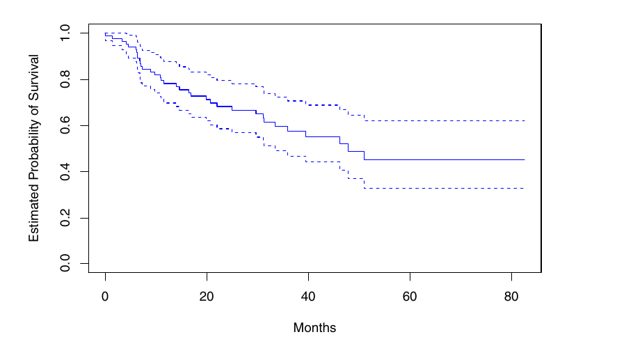

## 1. Intro

:::{.hidden}
\newcommand{\dydx}[1]{\frac{\mathrm{d}#1}{\mathrm{d}t}}
\newcommand{\ddt}[1]{\frac{\mathrm{d}}{\mathrm{d}t}#1}

\newcommand{\limitint}[4]{\int_{#2}^{#3} #4 \mathrm{d}#1}

\newcommand{\recip}[1]{\frac{1}{#1}}

\newcommand{\trans}[0]{^\mathsf{T}}
:::

```{r import_libs}
#| include: false
library(tidyverse)
library(gt)
```


- In survival analysis, we study the data where the outcome variable is the time until an event occurs.

- Eg: death of a cancer patient, re-employment of an unemployed worker, machine becoming unserviceable, etc.

- Survival analysis is powerful because it provides methods to deal with incomplete observation of time

## 2. Survival Time

- The time taken for for the event of interest to occur is called the *survival time*. The event occurring is referred to as *failure*.

- Hereafter, we will assume that failure can only occur once; unless specified.

- Survival time by the random variable $T \geq 0$.

# 3. Incomplete Observation of Time

## 3. Incomplete Observation of Time

- Incomplete observation of time can happen due to two reasons: i) *censoring* or ii) *truncation*.

- A *censored* observation is incomplete due to random factors.

- A *truncated* observation is incomplete due to a selection process inherent in the study design.


## 3.1. Censoring

- Data can be i) *right censored* ii) *left censored* or iii) *mid (interval) censored*

- The most common one is *right censoring*. It happens due to i) attrition or ii) the study ending before failure.

- *Left censoring* happens when the subject is observed after failure has occurred.

<!--- *Mid censoring* occurs when we don't have continuous data on the subject. Discrete data is mid censored. -->

- Hereafter, assume *censoring* to imply *right censoring*, unless specified otherwise.

## 3.1. Censoring (Contd.)

- Censoring is denoted by the random variable $\delta$.


. . .

$$
\delta = \begin{cases} 
    1 & \text{if failure} \\
    0 & \text{if censored} \\
\end{cases}
$$

## 3.2. Truncation

- Truncation are of two kinds: i) *left truncation* and ii) *right truncation*.

- *Left truncation*, also know as *delayed entry*, occurs when the subject enters the study after the time at which they were exposed to the possibility of failure. 

- Eg: Analysing survival time of individuals who had a cardiac arrest, but including them in the study only after they are discharged from the hospital post the arrest. We will miss out on the patients who died during hospitalization.

## 3.2. Truncation (contd.)

- *Right truncation* happens only the subjects who face failure within the period of analysis are included. This method of sampling is known as *length biased sampling*

- Eg: Analysing data from a death registry. Here, we only have individuals who died within the specified time.

- Truncation leads to selection bias in the study.

# 4. Some Key Functions of Survival Time

## 4.1. Survival Function

- Denoted by $S(t)$.

. . .

$$S(t) = \mathbb{P}(T > t)$$

- Gives the probability that a person survives longer than some specified time $t$.

- $S(0) = 1$ and $S(\infty) = 0$.

## 4.2. Hazard Function

- Denoted by $h(t)$

. . .

$$h(t) = \lim_{\Delta t \to 0 } \frac{\mathbb{P}(t < T \leq t + \Delta T | T \geq t)}{\Delta t}$$

- Gives the instantaneous potential per unit time for the event to occur, given that the individual has survived up to time t.

- Also known as the *conditional failure rate*

- $h(t) \geq 0$. Has no upper bound.

## 4.3 Cumulative Hazard Rate

- Denoted by $H(t)$.

. . .

$$H(t) = \limitint{u}{0}{t}{h(u)}$$

- Gives the sum total of the hazard up to time $t$.

## 4.3. Relationship between Survival & Hazard Functions{.smaller}

- 
$$
\begin{align}
S(t) &= \exp{\left(- \int_{0}^{t} h(u) du\right)}\\
&= \exp(- H(t))
\end{align}
$$

- 
$$
\begin{align}
h(t) &= - \left[\frac{\frac{d S(t)}{dt}}{S(t)} \right]\\
&= \frac{f(t)}{S(t)}
\end{align}
$$
where $f(t)$ is the probability density function of survival time.

## 4.3.1. Derivation of Hazard Function from Survival Function {.scrollable .smaller}

. . .

$$
\begin{aligned}
&& S(t) &= \mathbb{P}(T > t)\\
& \Rightarrow 
& \frac{dS(t)}{dt} 
&= \lim_{\Delta t \to 0 } \frac{\mathbb{P}(T > t + \Delta t) - \mathbb{P}(T > t)}{\Delta t}\\
& \Rightarrow
& -\frac{dS(t)}{dt} 
&= \lim_{\Delta t \to 0 } \frac{\mathbb{P}(T > t) - \mathbb{P}(T > t + \Delta t)}{\Delta t}\\
&&& = \lim_{\Delta t \to 0 } \frac{\mathbb{P}(t < T \leq t + \Delta t)}{\Delta t}\\
&&& = \lim_{\Delta t \to 0 } \frac{\mathbb{P}(t < T \leq t + \Delta t, T > t)}{\Delta t}\\
& \Rightarrow
& - \left[\frac{\frac{d S(t)}{dt}}{S(t)} \right] 
&= \lim_{\Delta t \to 0 } \frac{1}{\Delta t} \frac{\mathbb{P}(t < T \leq t + \Delta t, T > t)}{\mathbb{P}(T > t)}\\
&&& = \lim_{\Delta t \to 0 } \frac{\mathbb{P}(t < T \leq t + \Delta t | T > t)}{\Delta t} \\
& \Rightarrow
& - \left[\frac{\frac{d S(t)}{dt}}{S(t)} \right]
&= h(t)
\end{aligned}
$$

- Moreover,
$$
\begin{aligned}
f(t) &= \lim_{\Delta t \to 0 } \frac{\mathbb{P}(T > t) - \mathbb{P}(T > t + \Delta t)}{\Delta t}\\
&= -\frac{dS(t)}{dt} 
\end{aligned}
$$

- Hence,
$$
h(t) = \frac{f(t)}{S(t)}
$$

## 4.3.2. Derivation of Survival Function from Hazard Function {.scrollable .smaller}

. . .

$$
\begin{aligned}
&& \ddt{\ln{S(t)}} &= \recip{S(t)} \ddt{S(t)} \\
& \Rightarrow
& -\ddt{\ln{S(t)}} &= - \recip{S(t)} \ddt{S(t)} \\
&&&= h(t)
\end{aligned}
$$

. . .

Integrate both sides wrt. a dummy variable $u$, from $0$ to $t$.

. . .

$$
\begin{aligned}
&& -\limitint{u}{0}{t}{\ddt{\ln{S(u)}}} &= \limitint{u}{0}{t}{h(u)}\\
& \Rightarrow
& - [\ln S(t) - \ln S(0)] &= \limitint{u}{0}{t}{h(u)}\\
& \Rightarrow
& - [\ln S(t) - \ln(1)] &= \limitint{u}{0}{t}{h(u)}\\
& \Rightarrow
& \ln S(t) &= - \limitint{u}{0}{t}{h(u)}\\
& \Rightarrow
& S(t) &= \exp \left( -\limitint{u}{0}{t}{h(u)} \right)
\end{aligned}
$$

# 5. Non-Parametric Models in Survival Analysis

## 5. Non-Parametric Models in Survival Analysis

- Descriptive statistics about about survival time, such as average survival time, are not helpful as they do not account for censoring.

- Non-parametric models help us estimate survival functions without assuming what kind of a distribution the data follows.


# 5.1. The Kaplan Meier Estimator 

## 5.1.  Kaplan Meier (KM) Estimator


- Let $t_1 < \dots < t_k$ be an ordered set of failure times.

. . .

$$
\begin{aligned}
\widehat{S}(t_k)
&= \prod_{j = 1}^{k} \widehat{\mathbb{P}}(T > t_j | T > t_{j-1})\\
&= \prod_{j = 1}^{k} \left(\frac{r_j - q_j}{r_j}\right)
\end{aligned}
$$

. . .

where $r_j$ is the number of individuals at risk of failure at $t_j$, and $q_j$ is the number of individuals who fail at $t_j$.

## 5.1.1. Risk Set {.scrollable}

- Let $R(t)$ bet the set of subjects which have not been censored/failed till time $t$, It is called the  *risk set*, as it is the set of subjects at risk of failure at that time.

- $r_t = |R(t)|$

## 5.1.2. Derivation of KM Estimator {.scrollable .smaller}

. . .

$$
\widehat{S}(t) = \widehat{\mathbb{P}}(T > t_k)
$$


- Using the law of total probability,
$$
\begin{aligned}
\widehat{S}(t_k)
&= \widehat{\mathbb{P}}(T > t_k | T > t_{k-1})\widehat{\mathbb{P}}(T > t_{k-1}) \\
& \qquad + \widehat{\mathbb{P}}(T > t_k | T \leq t_{k-1})\widehat{\mathbb{P}}(T \leq t_{k-1}) \\
&= \widehat{\mathbb{P}}(T > t_k | T > t_{k-1})\widehat{\mathbb{P}}(T > t_{k-1}) + 0\\
&= \widehat{\mathbb{P}}(T > t_k | T > t_{k-1})\widehat{S}(t_{k-1})
\end{aligned}
$$

- The recursive expression above can be expanded into: 
$$
\begin{aligned}
\widehat{S}(t_k)
&= \widehat{\mathbb{P}}(T > t_k | T > t_{k-1})\widehat{\mathbb{P}}(T > t_{k-1} | T > t_{k-2}) \ldots \widehat{\mathbb{P}}(T > t_1 | T > 0) \widehat{S}(0) \\
\end{aligned}
$$

- We know that $S(0) = 1$

- Hence the above expression can be written as an indexed product.
$$
\begin{aligned}
\widehat{S}(t_k)
&= \prod_{j = 1}^{k} \widehat{\mathbb{P}}(T > t_j | T > t_{j-1})\\
&= \prod_{j = 1}^{k} \frac{\widehat{\mathbb{P}}(T > t_j,  T > t_{j - 1})}{\widehat{\mathbb{P}}(T > t_{j-1})}\\
&= \prod_{j = 1}^{k} \frac{\widehat{\mathbb{P}}(T > t_j)}{\widehat{\mathbb{P}}(T > t_{j-1})}\\
&= \prod_{j = 1}^{k} \left(\frac{r_j - q_j}{r_j}\right)
\end{aligned}
$$

## 5.1.3. Variance of KM Estimator


- Given by the expression
$$
\widehat{\text{Var}}[\widehat{S}(t)] \cong [\widehat{S}(t)]^2 \left[\sum_{j = 1}^t \frac{q_j}{r_j(r_j - d_j)}\right]
$$

## 5.1.3.1 The Delta Method{.scrollable .smaller}

- Used in deriving the variance of KM Estimator

- Let $X$ be a random variable and $f(X)$ be a smooth (i.e. infinitely differentiable) function.

- Taking the first two terms of the Taylor series expansion of $f(X)$ around $\mu_X$,
$$
\begin{align}
&& f(X) &\cong f(\mu_X) + (X - \mu_X) f'(\mu_X)\\
& \Rightarrow
& \text{Var}[f(x)] &\cong \text{Var} [f(\mu_X) + (X - \mu_X) f'(\mu_X)]\\
&&& = \text{Var} [(X - \mu_X) f'(\mu_X)] \\
&&& = [f'(\mu_X)]^2 \text{Var}[X - \mu_X]\\
&&& = [f'(\mu_X)]^2 \text{Var}[X]\\
&&& = \sigma_X^2[f'(\mu_X)]^2\\
\end{align}
$$

- Take $f(X) = \ln(X)$
$$
\text{Var}[\ln(X)] \cong \sigma_X^2 \recip{\mu_X^2}
$$

- Take $f(X) = \exp(X)$
$$
\text{Var}[\exp(X)] \cong \sigma_X^2 [\exp(\mu_X)]^2
$$

## 5.1.3.2. Derivation of Variance of KM Estimator {.scrollable .smaller}

- Take $ln$ of the KM Estimator
$$
\begin{aligned}
&&
\widehat{S}(t)
&= \prod_{j = 1}^{t} \left(\frac{r_j - q_j}{r_j}\right)\\
& \Rightarrow
& \ln(S(t)) &= \sum_{j = 1}^t \left(\frac{r_j - q_j}{r_j}\right)\\
\end{aligned}
$$

- Let $\widehat{p}_j = \frac{r_j - q_j}{r_j}$
$$
\ln(S(t)) = \sum_{j = 1}^t p_t
$$

- Consider observations in the risk set at time $j$ to independent Bernoulli observations with constant probability $p_j$. Hence,
$$
\mu_X = \widehat{p}_j\\
\sigma^2_X = \frac{\widehat{p}_j (1 - \widehat{p}_j)}{r_j}
$$

- From the pervious slide,
$$
\begin{aligned}
\widehat{\text{Var}}[\ln(\widehat{p})] &\cong \recip{\mu_X^2} \sigma_X^2\\
&= \recip{\widehat{p}_j^2} \frac{\widehat{p}_j (1 - \widehat{p}_j)}{r_j}\\
&= \frac{q_j}{r_j(r_j - d_j)}
\end{aligned}
$$

- Assume that observations at each time are independent. Hence,
$$
\begin{align}
\widehat{\text{Var}}[\ln(\widehat{S}(t))] &= \sum_{j = 1}^t \widehat{\text{Var}}[\ln(\widehat{p_i})]\\
&= \sum_{j = 1}^t \frac{q_j}{r_j(r_j - d_j)}
\end{align}
$$

- Let $Y = \ln[\widehat{S}(t)]$. $\sigma_Y^2$ is given by the estimator above. Approximate $\mu_Y$ by $\ln[\widehat{S}(t)]$. From the previous slide,
$$
\begin{align}
\text{Var}[\exp(Y)] &\cong[\exp(\mu_Y)]^2 \sigma_Y^2 \\
&\cong \exp(\ln[\widehat{S}(t)]) \left[\sum_{j = 1}^t \frac{q_j}{r_j(r_j - d_j)}\right]\\
&= [\widehat{S}(t)]^2 \left[\sum_{j = 1}^t \frac{q_j}{r_j(r_j - d_j)}\right]
\end{align}
$$

- We can use this below,
$$
\begin{align}
&& \widehat{S}(t) &= \exp\{\ln[\widehat{S}(t)]\}\\
&&& = \exp(Y)\\
& \Rightarrow
& \widehat{\text{Var}}[\widehat{S}(t)] &= \widehat{\text{Var}}[\exp(Y)]\\
&&& = [\widehat{S}(t)]^2 \left[\sum_{j = 1}^t \frac{q_j}{r_j(r_j - d_j)}\right]
\end{align}
$$

## 5.1.5. 

## 5.1.5. KM Curve

{fig-align="center"}

## 5.2 Uncovered Topics

:::{.nonincremental}
- Confidence Interval of KM Estimator <!-- Se pg 41 - 55 Provide overview not details. Expland on only log-log>
- Statistical tests
- The Nelson Aarlen Estimator (For cumulative hazard)
:::

# 6. Semi - Parametric Models for Survival Analysis

## 6.1. The Cox Proportional Hazard (PH) Model

- If we intend to obtain the survivor or hazard function while controlling for a set of covariates, we use the Cox PH Model,

- It is a semi-parametric model, which assumes the hazard function to take a following form:
$$
h(t|\mathbf{X_i}) = h_0(t) \exp (\boldsymbol{\beta}^\mathsf{T} \mathbf{X_i})
$$
where $h_0 \geq 0$ is an unspecified baseling hazard function, and $\mathbf{X_i}$ is vector of time-independent covariates for observation $i$.

## 6.2 Why is Cox PH Semi-Parametric?

- **The PH Assumption:** The model makes some assumptions about the functional form for the hazard function.

- **Unspecified Baseline:** However, the baseline function ($h_0$) is unspecified.

- These makes the model flexible. If the data does have an underlying parametric distribution, the Cox PH model will approximate it.

- However, these also affect when we can apply the model, and how we interpret it.

## 6.3 Hazard Ratio

- Take two vectors of covariates $\mathbf{X_i}$ and $\mathbf{X_j}$.

- The Hazard Ratio is given by:
  $$
  \begin{align}
  \widehat{HR} &= \frac{\widehat{h}(t, \mathbf{X_i})}{\widehat{h}(t, \mathbf{X_j})}\\
  &= \frac{h_0(t) \exp (\boldsymbol{\beta}^\mathsf{T} \mathbf{X_i})}{h_0(t) \exp (\boldsymbol{\beta}^\mathsf{T} \mathbf{X_j})} \\
  &= \exp (\boldsymbol{\beta}^\mathsf{T} (\mathbf{X_i} - \mathbf{X_j}))
  \end{align}
  $$

- A result of the PH assumption is that the HR stays constant over time.

## 6.4. Survival Function from Cox PH Model

. . .

$$
\widehat{S}(t) = S_0(t)^{\exp(\boldsymbol{\beta}^\mathsf{T} \mathbf{X})}
$$
where $S_0(t) = \exp(-H_0(t))$ is the baseline survival function

## 6.4.1 Derivation of Survival Function from Cox PH Model{.scrollable .smaller}

. . .

$$
\begin{align}
\widehat{S}(t) &= \exp\left(- \limitint{u}{0}{t}{h(u, \mathbf{X})}\right)\\
&= \exp\left(- \limitint{u}{0}{t}{h_0(u)\exp(\boldsymbol{\beta}^\mathsf{T} \mathbf{X})} \right)\\
&= \exp\left(-\exp(\boldsymbol{\beta}^\mathsf{T} \mathbf{X}) \limitint{u}{0}{t}{h_0(u)} \right)\\
&= \exp\left(-\exp(\boldsymbol{\beta}^\mathsf{T} \mathbf{X}) H_0(t) \right)\\
&= \exp(-H_0(t) \times \exp(\boldsymbol{\beta}^\mathsf{T} \mathbf{X}))\\
&= \exp(-H_0(t))^{\exp(\boldsymbol{\beta}^\mathsf{T} \mathbf{X})}\\
&= S_0(t)^{\exp(\boldsymbol{\beta}^\mathsf{T} \mathbf{X})}
\end{align}
$$


## 6.5.1 Cox Likelihood without Ties {.smaller .scrollable}

- Given we are leaving $h_0$ unspecified, we maximize only the partial likelihood of Cox PH.

- For simplicity, assume there are no ties in in time of failure.

- Take an uncensored observation $i$ with failure time $t_i$.

- The hazard function for the $i^\text{th}$ observation at time $t_i$ is $h(t_i|\mathbf{X}_i) =  h_0(t_i) \exp (\boldsymbol{\beta} \mathbf{X}_i)$.

- The total hazard for at time $t_i$ for the at risk population is $\sum_{i^\prime: t_{i^\prime} \geq t_i} h_0(t_i) \exp(\boldsymbol{\beta}^\mathsf{T} \mathbf{X}_{i^\prime})$

- Thus, the probability that observation $i$ is the one to fail at observation $t_i$ is $\frac{h_0(t_i) \exp(\boldsymbol{\beta}^\mathsf{T} \mathbf{X}_i)}{h_0(t_i) \sum_{i^\prime: T_{i^\prime} \geq t_i} \exp(\boldsymbol{\beta}\trans \mathbf{X}_{i^\prime})} = \frac{\exp(\boldsymbol{\beta}\trans \mathbf{X}_i)}{\sum_{i^\prime: T_{i^\prime} \geq t_i} \exp(\boldsymbol{\beta}\trans \mathbf{X}_{i^\prime})}$

- We get the partial likelihood by taking a product of these probabilities over all uncensored observations.
  $$
  l_p(\boldsymbol{\beta}) = \prod_{i:\delta_i = 1} \frac{\exp(\boldsymbol{\beta}\trans \mathbf{X}_i)}{\sum_{i^\prime: T_{i^\prime} \geq t_i} \exp(\boldsymbol{\beta}\trans \mathbf{X}_{i^\prime})}
  $$

## 6.5.2 Cox Likelihood with Ties {.smaller .scrollable}

- Assume we have $r$ distinct failure times with $d_l$ failures at the $l^\text{th}$ distinct time. $t^*_{11} = t^*_{12} = \cdots = t^*_{1d_1} < t^*_{21} = t^*_{22} = \cdots = t^*_{2d_2} < \cdots \\ \hspace{18em} < t^*_{r1} = t^*_{r2} = \cdots = t^*_{rd_r}$

- Let $\mathbf{X}^*_{lj}$ be the vector of covariates for the observation that fails at time $t^*_{lj}$. Let $\mathbf{X}^*_{l} = \sum_{j=1}^{d_l}{\mathbf{X}^*_{lj}}$.

- Suppose we knew $t^*_{l1} < t^*_{l2} < \dots < t^*_{ld_l}$. Let $B(t_{lj})$ be the set of individuals failing at $t^*_{l1}, t^*_{l2}, \dots, t^*_{ld_l}$

- In this case the Cox Likelihood would be:
  $$
  \begin{align}
  l_p(\boldsymbol{\beta}) 
  &=
  \prod_{l=1}^r\prod_{j=1}^{d_l}\frac{\exp(\boldsymbol{\beta}\trans \mathbf{X}^*_{lj})}{\sum_{i:i \in R(t^*_{l1}) \setminus B(t^*_{l(j-1))})} \exp(\boldsymbol{\beta}\trans \mathbf{X}_i)} 
  \\&= 
  \prod_{l=1}^r\frac{\prod_{j=1}^{d_l}{\exp(\boldsymbol{\beta}\trans \mathbf{X}^*_{lj})}}{\prod_{j=1}^{d_l} \left[ \sum_{i:i \in R(t^*_{l1}) \setminus B(t^*_{l(j-1)})} \exp(\boldsymbol{\beta}\trans \mathbf{X}_i)\right]} 
  \\&= 
  \prod_{l=1}^r{\frac{\exp(\boldsymbol{\beta}\trans \mathbf{X}^*_l)}{\prod_{j=1}^{d_l} \left[ \sum_{i: i \in R(t^*_{l1})} \exp(\boldsymbol{\beta}\trans \mathbf{X}^*_i) - \sum_{i: i \in B(t^*_{l(j-1)})} \exp(\boldsymbol{\beta}\trans \mathbf{X}_i) \right]} }
  \end{align}
  $$

- However, we don't know $t^*_{l1} < t^*_{l2} < \dots < t^*_{ld_l}$ due to ties. Hence, we cannot estimate $\sum_{i:i \in B(t^*_{l(j-1)})} \exp(\boldsymbol{\beta}\trans \mathbf{X}^*_i)$.

- We shall consider two ways of approximating the likelihood.

- However, *hazard ratios* can be only obtained between two individuals in the same strata.

- **Breslow Correction:** Ignore the sum. Hence, the Cox likelihood becomes:
  $$
  \begin{align}
  l_p(\boldsymbol{\beta})
  &= 
  \prod_{l=1}^r \frac{\exp(\boldsymbol{\beta}\trans \mathbf{X}^*_l)}{ \left[ \sum_{i: i \in R(t^*_{l1})} \exp(\boldsymbol{\beta}\trans \mathbf{X}_i) \right]^{d_l}}
  \end{align}
  $$

- **Efron Correction:** Replace the sum by $j-1$ times the average.
  $$
  \sum_{i: i \in B(t^*_{l(j-1)})} \exp(\boldsymbol{\beta}\trans \mathbf{X}_i) \approx (j -1) \frac{1}{d_l} \sum_{k=1}^{d_l}  \exp(\boldsymbol{\beta}\trans \mathbf{X}^*_{lk})
  $$
  Hence, the Cox likelihood becomes:
  $$
  \begin{align}
  l_p(\boldsymbol{\beta})
  =
  \prod_{l=1}^r{\frac{\exp(\boldsymbol{\beta}\trans \mathbf{X}^*_l)}{\prod_{j=1}^{d_l} \left[ \sum_{i: i \in R(t^*_{l1})} \exp(\boldsymbol{\beta}\trans \mathbf{X}^*_{l^\prime j}) - (j -1) \frac{1}{d_l} \sum_{k=1}^{d_l}  \exp(\boldsymbol{\beta}\trans \mathbf{X}^*_{lk}) \right]} }
  \end{align}
  $$

- The *Berslow Estimator* is computationally simpler but more biased to underestimation compared to the *Effron Correction*.

## 6.6. Stratified Cox PH Model

- In cases where the data violates the PH assumption, but it holds in different strata of the data, we can use a stratified Cox PH Model

. . .

$$
h_s(t|\mathbf{X_i}) = h_{s0}(t) \exp (\boldsymbol{\beta}^\mathsf{T} \mathbf{X_i})
$$
where the subscript $s$ represents different strata

- This allows for each strata to have a different baseline hazard function.

## 6.7. Cox PH Models with Time Dependence 

- When there covariates that vary with time, we can take the covariates as a function of time.
$$
h(t|\mathbf{X_i(t)}) = h_{s}(t) \exp (\boldsymbol{\beta}^\mathsf{T} \mathbf{X_i(t)})
$$

- We can also model the change in effects of fixed covariates with time.
$$
h(t|\mathbf{X_i}) = h_{s}(t) \exp (\boldsymbol{\beta(t)}^\mathsf{T} \mathbf{X_i})
$$
This can be estimated using a linear additive model.

## 6.7. Cox PH Models with Time Dependence (contd.)

- The both scenarios can also be combined.
$$
h(t|\mathbf{X_i(t)}) = h_{s}(t) \exp (\boldsymbol{\beta(t)}^\mathsf{T} \mathbf{X_i(t)})
$$

## 6.8. Uncovered Topics 

:::{.nonincremental}
- Testing if the PH assumption holds
- Estimating the survival function in Cox PH Model<!-- Clear doubts in pg 88 (pg 99 of pdf) -->
- Variance & confidence interval of estimates 
- Statistical tests
- Goodness of fit measures
- Linear additive model
:::

# 7. Competing Risks Models 

## 7.1 Competing Risks Models

- Competing Risk Models allow for there to be risks of different kinds.

- Let $\delta = c$ whre $c=0$ denotes censoring and $c = 1, \dots, C$ different kinds of failures.

- We will assume each failure type as mutually exclusive. Under this framework, if we want allow for the possibility of multiple failures, we consider each combination as a usique failure type.

- We will also assume no recurrence.

## 7.2 Cause Specific Functions 

- Cause specific hazard function sum up to the cumuative hazrd at a point of time.
$$
h(t) = \sum_{c=1}^C h_c(t) 
$$

- Cause specific cumulative hazard
$$
H_c(t) = \limitint{u}{0}{t}{h_c(t)}
$$

## 7.2 Cause Specific Functions (contd.)

- Overall hazard
$$
H(t) = \sum_{j=1}^k H_c(t)
$$

- Survival Function
$$
S(t) = e^{-H(t)}
$$

## 7.3 Cumulative Incidence Function (CIF)

- The CIF provides the marginal probability of failure occuring in the presence of competing failures.

- The CIF is given by
$$
\begin{align}
F_c(t) &= \mathbb{P}(T \leq t, \delta = c)\\
&= \limitint{u}{0}{t}{h_c(u)S(u)}
\end{align}
$$


## CIF (contd.)

- From this, we can obtain the total distribution function
$$
F(t) = \sum_{c=1}^CF_c(t)
$$

- It can also be defined as
$$
F(t) = 1 - S(t)
$$

## 7.4 Estimating CIF

- For ordered failure times $t_j$, we estimate the hazard for failure type $c$ as 
$$
\hat{h}(t_j, c) = \frac{q_{cj}}{r_j}
$$
where $q_cj$ is the number of failured of type $c$ at $t_j$, and $r_j$ is the population at risk in the time.

- From this, the CIF can be estimated as
$$
F(t_j, c) = \sum_{j \prime = 1}^j\hat{h}_c(t_{j\prime})\hat{S}(T_{j\prime-1})
$$

## 7.5 Fine-Grey Model 

- We can estimate competing riks with covariates with _subdistribution hazards_, using the method provided in Fine & Grey (1988). 

- The risk set for individual $i$ facing failure type $c$ is defined as
$$
R_i = {j: (T_j \geq T_i) \cup (T_j \leq T_i \cap \delta_i \neq c)}
$$

- The subdistribution hazard function for the same is defined as
$$
h_c(t)
=
\lim_{\Delta t \to 0}
\frac{\mathbb{P}\left(t < T_c \leq t + \Delta t\mid T_i > t \cup (T_{c^\prime} \leq t \cap c^\prime \neq c)\right)
}{
\Delta t
}
$$


## 7.5 Fine-Grey Model (contd.)

- Similar to a Cox PH model, we can obtain _subdistribution hazard ratios (SHR)_ from the Fine-Grey Model


- These can also be used to estimate the CIF. The mathematical details of the same have not been covered here.

## 7.6 Lunn-McNeil Model

- In the previous methods, we estimate a separate models for each risk.

- The Lunn-McNeil method allows to use a single model.

- It requires duplication of data and modifed version of the stratified Cox PH model.

## 7.6.1 Data Duplication {.smaller .scrollable}

- Consider the following illustration of survival data unemployed inidividuals:

. . .

```{r duplication_eg_1}
tibble(
  id = 101:104,
  time = c(13, 2, 9, 6),
  status = c("censored", "employed", "discouraged", "olf"),
  covariates = c(
    "X<sub>101</sub>",
    "X<sub>102</sub>",
    "X<sub>103</sub>",
    "X<sub>104</sub>"
  )
) |>
  gt() |>
  tab_style(
    style = cell_text(weight = "bold"),
    locations = cells_column_labels()
  ) |>
  fmt_markdown()
```

- We duplicate this as follows:

. . .

```{r duplication_eg_2}
tibble(
  id = rep(101:104, each = 3),
  time = rep(c(13, 2, 9, 6), each = 3),
  status = c(rep(0, 3), c(1, 0, 0), c(0, 1, 0), c(0, 0, 1)),
  employed = rep(c(1, 0, 0), 4),
  discouraged = rep(c(0, 1, 0), 4),
  olf = rep(c(0, 0, 1), 4),
  covariates = rep(
    c(
      "X<sub>101</sub>",
      "X<sub>102</sub>",
      "X<sub>103</sub>",
      "X<sub>104</sub>"
    ),
    each = 3
  )
) |>
  gt() |>
  tab_style(
    style = cell_text(weight = "bold"),
    locations = cells_column_labels()
  ) |>
  cols_width(
    everything() ~ pct(12)
  ) |>
  fmt_markdown()
```

- In general form, this will be:

. . .

```{r duplication_eg_general}
tibble(
  id = rep(101:104, each = 3),
  time = rep(c(13, 2, 9, 6), each = 3),
  status = c(rep(0, 3), c(1, 0, 0), c(0, 1, 0), c(0, 0, 1)),
  D1 = rep(c(1, 0, 0), 4),
  D2 = rep(c(0, 1, 0), 4),
  D3 = rep(c(0, 0, 1), 4),
  covariates = rep(
    c(
      "X<sub>101</sub>",
      "X<sub>102</sub>",
      "X<sub>103</sub>",
      "X<sub>104</sub>"
    ),
    each = 3
  )
) |>
  gt() |>
  fmt_markdown() |>
  cols_label(
    D1 = md("D<sub>1</sub>"),
    D2 = md("D<sub>2</sub>"),
    D3 = md("D<sub>3</sub>")
  ) |>
  tab_style(
    style = cell_text(weight = "bold"),
    locations = cells_column_labels()
  ) |>
  cols_width(
    everything() ~ pct(12)
  )
```

## 7.6.2 Functional Form {.scrollable}

$$
\begin{align}
h_c(t|\mathbf{X}) &= h_{c0}(t) \exp (\beta_1 X_1 + \beta_2X_2 + \dots + \beta_pX_p + \\
&\delta_{21}D_2X_1 + \delta_{22}D_2X_2 + \dots + \delta_{2p}D_2X_p + \\
& \qquad \qquad \qquad \qquad \qquad \  \vdots \\
&\delta_{C1}D_CX_1 + \delta_{C2}D_CX_2 + \dots + \delta_{Cp}D_CX_p)
\end{align}
$$
where $c = 1, \dots, C$ denotes the type of failure. $D_2, \dots, D_C$ are dummies representing each failure type except the baseline one.

- The linear function for observation with failure type $c=1$ reduces to $\beta_1X_1 + \dots + \beta_pX_p$

- The linear function for observation with failure type $c\neq1$ reduces to $(\beta_1 + \delta_{1c})X_1 + \dots + (\beta_p + \delta_{pc})X_p$

# Parametric Models

## Exponential Model

- Assumes constant hazard function, $h(t) = h$

$$
S(t) = \exp(-ht)
$$

## Weibull Model

- This a parametric distribution

- The hazard function takes the following form: $h(t, \mathbf{X}) = \lambda(t, \mathbf{X}) p t^{p-1}$ <br>
where $\lambda(t, \mathbf{X}) = \exp(\beta_0 + \boldsymbol{\beta}\trans\mathbf{X}) > 0$ and $p>0$

- Here, $\lambda$ is called the *scale parameter* and $p$ is called the shape parameter.

- [Simulation of Weibull Distribution](https://sesen.ai/distribution-explorer/weibull)

## Shape & Hazard in Weibull Model

- $p>1 \implies$ hazard increases over time.

- $p=1 \implies$ constant hazard (equivalent to an exponential model where $h(t) = \lambda(t)$).

- $p<1 \implies$ hazard decreases over time.

## Hazard Ratio in a Weibull Model

- Take two different observation $i$ and $j$ with covariates $\mathbf{X}_i$ and $\mathbf{X}_j$ respectively.

- The *hazard ratio* is given by:
  $$\begin{align}
  \widehat{HR} &= \frac{\widehat{h}(t, \mathbf{X_i})}{\widehat{h}(t, \mathbf{X_j})}\\
  &= \frac{\exp (\beta_0 + \boldsymbol{\beta}\trans \mathbf{X_i}) p t^{p-1}} {\exp (\beta_0 + \boldsymbol{\beta}\trans \mathbf{X_j}) p t^{p-1}} \\
  &= \exp (\boldsymbol{\beta}\trans(\mathbf{X_i} - \mathbf{X_j}))
  \end{align}$$

## The Accelerated Failure Time (AFT) Assumption

- Take $T_1$ and $T_2$ to be the survival times associated with two groups, the AFT assumption says that $T_1 = \gamma T_2$ and $S(t_1) = S(\gamma t_2), \forall t$

- Just like the underlying assumption in **PH models** is that the *effect of covariates* is *multiplicative* with respect to the ***hazard***, the underlying assumption in the **AFT Models** is that the *effect of covariates* is *multiplicative* with respect to ***survival time***.

- The $\lambda$ here is known as the **Acceleration Factor**.

## AFT in Weibull Model {.scrollable}

- We can estimate the Weibull survivor function from the hazard function:
  $$\begin{align}
  &&
  h(t, \mathbf{X}) &= \lambda(t, \mathbf{X}) p t^{p-1}\\
  &
  \Rightarrow & S(t, \mathbf{X}) &= \exp(-\lambda(t, \mathbf{X}) t^p)
  \end{align}$$

- Take $t$ to the LHS:
  $$\begin{align}
  t &= [- \ln S(t, \mathbf{X})]^{\frac{1}{p}} \times \frac{1}{\lambda(t, \mathbf{X}) ^ {\frac{1}{p}}}
  \end{align}$$

- Reparametrize $\frac{1}{\lambda(t, \mathbf{X}) ^ \frac{1}{p}} = \exp(\alpha_0 + \boldsymbol{\alpha}\trans \mathbf{X})$

- Now, $t = [- \ln (S(t, \mathbf{X}))]^{\frac{1}{p}} \times \exp(\alpha_0 + \boldsymbol{\alpha}\trans \mathbf{X})$

- Let $S(t, \mathbf{X_j}) = q$ <br> By AFT, $S(\lambda t, \mathbf{X_i}) = q$

- Using the above definition of t,
  $$\begin{align}
  &&
  \lambda &= \frac{\lambda t}{t}\\
  &&&= 
  \frac{[- \ln (S(\lambda t, \mathbf{X_i}))]^{\frac{1}{p}} \times \exp(\alpha_0 + \boldsymbol{\alpha}\trans \mathbf{X_j})} {[- \ln (S(\lambda t, \mathbf{X_j}))]^{\frac{1}{p}} \times \exp(\alpha_0 + \boldsymbol{\alpha}\trans \mathbf{X_i})}\\
  &&&= 
  \frac{[- \ln (q)]^{\frac{1}{p}} \times \exp(\alpha_0 + \boldsymbol{\alpha}\trans \mathbf{X_i})} {[- \ln (q)]^{\frac{1}{p}} \times \exp(\alpha_0 + \boldsymbol{\alpha}\trans \mathbf{X_j})}\\
  & \Rightarrow &
  \lambda &= \exp(\boldsymbol{\alpha}\trans (\mathbf{X_i} - \mathbf{X_j}))
  \end{align}$$

## AFT & PH in Weibull {.scrollable}

- In a Weibull model, if $p$ is fixed, AFT $\iff$ PH.

- We can also derive a relationship between the coefficients.

- Under AFT,
  $$\begin{align}
  && 
  \frac{1}{\lambda ^ \frac{1}{p}} &= \exp(\alpha_0 + \boldsymbol{\alpha}\trans \mathbf{X}) \\
  &\Rightarrow&
  (1-p)\ln(\lambda)
  &= - (\alpha_0 + \boldsymbol{\alpha}\trans \mathbf{X}) \\
  &\Rightarrow&
  \ln(\lambda) &= -p (\alpha_0 + \boldsymbol{\alpha}\trans \mathbf{X})
  \end{align}$$

- Under PH
  $$\begin{align}
  &&
  \lambda &= \exp (\beta_0 + \boldsymbol{\beta}\trans \mathbf{X})\\
  & \Rightarrow &
  \ln(\lambda) &= \beta_0 + \boldsymbol{\beta}\trans \mathbf{X}
  \end{align}$$

- Hence, $\beta_0 = - \alpha_0$ and $\beta = - \alpha$

## References {.smaller}

::: nonincremental
- *Breslow vs Efron tie handling in Cox proportional hazards.* (2026). MetricGate. <https://metricgate.com/blogs/breslow-vs-efron-tie-handling-cox/>

- Fine, J. P., & Gray, R. J. (1999). *A Proportional Hazards Model for the Subdistribution of a Competing Risk.* Journal of the American Statistical Association, 94(446), 496–509. <https://doi.org/10.2307/2670170>

- Hosmer, D. W., Lemeshow, S., & May, S. (2011). *Applied survival analysis: Regression modeling of time to event data* (2nd ed). John Wiley & Sons.

- James, G., Witten, D., Hastie, T., & Tibshirani, R. (2021). *An introduction to statistical learning: With applications in R* (2nd ed). Springer. <https://www.statlearning.com/>

- Kleinbaum, D. G., & Klein, M. (2005). *Survival analysis: A self-learning text* (2nd ed). Springer.

- Waagepetersen, R. (2024, Semptember 29). *Cox’s proportional hazards model and Cox’s partial likelihood.* Aalborg University. <https://people.math.aau.dk/~rw/Undervisning/DurationAnalysis/Slides/lektion3.pdf>
:::