## 1. Context

:::{.hidden}
\newcommand{\dydx}[1]{\frac{\mathrm{d}#1}{\mathrm{d}t}}
\newcommand{\ddt}[1]{\frac{\mathrm{d}}{\mathrm{d}t}#1}

\newcommand{\limitint}[4]{\int_{#2}^{#3} #4 \mathrm{d}#1}

\newcommand{\recip}[1]{\frac{1}{#1}}

\newcommand{\trans}[0]{^\mathsf{T}}
:::

```{r setup}
#| include: false
rm(list = ls())
if (!require("pacman")) {
  install.packages("pacman")
}
pacman::p_load(
  here,
  tidyverse,
  survival,
  ggsurvfit,
  stargazer,
  knitr,
  plotly
)

read_location <- here(
  "data",
  "eda",
  "2026-08-28_lab_presentation_01",
  "models"
)

draw_km <- function(
  km_model,
  x_text = "Time (in Months)",
  y_text = "Probability of Remaining Non-Employed"
) {
  model <- read_rds(here(read_location, paste0(km_model, ".rds")))

  plot <- ggsurvfit(model) +
    add_confidence_interval() +
    labs(
      x = x_text,
      y = y_text
    )
  return(plot)
}

source("code/utilities.R")
theme_set(theme_classic() + theme(legend.position = "bottom"))
```

- **Broad Area:** Model labour market transitions in India using a panel dataset and observe differences among different social groups and across different time periods.

- **(Working) Question:** How long do males in urban India stay unemployed, and what kind of exits from unemployment do they make? 

- **Key Methodology:** Survival Analysis

# 2. Survival Analysis 101

## 2.1. Survival Analysis

- Survival analysis provides methods to study the data where the outcome variable is the time until an event occurs.

- Eg: death of a cancer patient, re-employment of an unemployed worker, machine becoming unserviceable, etc.

- It is powerful because it provides methods to deal with incomplete observation of time

## 2.2. Survival Time

- The time taken for for the event of interest to occur is called the *survival time*. The event occurring is referred to as *failure*.

- For now, we will assume that there is only one kind of failure and it can only occur once.

- Survival time by the random variable $T \geq 0$.


## 2.3. Censoring

- *Censoring* refers to incomplete observation of data due to random factors

- **Right Censoring:** Attrition or study ending before failure. 

- **Left Censoring:** Subject not observed from time of origin.

- **Mid/Interval censoring:** Combination of the above.

- Hereafter, assume *censoring* to imply *right censoring*, unless specified otherwise.

## 2.3. Censoring (Contd.)

- Censoring is denoted by the random variable $\delta$.

. . .

$$
\delta = \begin{cases} 
    1 & \text{if failure} \\
    0 & \text{if censored} \\
\end{cases}
$$

## 2.4.1. Survival Function

- Denoted by $S(t)$.

. . .

$$
S(t) = \mathbb{P}(T > t)
$$

- Gives the probability that a person survives longer than some specified time $t$.

- $S(0) = 1$ and $S(\infty) = 0$.

## 2.4.2. Hazard Function

- Denoted by $h(t)$

. . .

$$h(t) = \lim_{\Delta t \to 0 } \frac{\mathbb{P}(t < T \leq t + \Delta T | T \geq t)}{\Delta t}$$

- Gives the instantaneous rate of failure to occur, given that the individual has survived up to time t.

- Also known as the *conditional failure rate*.

- $h(t) \geq 0$. Has no upper bound.

## 2.5.1. The KM Estimator{.smaller}

- The *Kaplan Meier (KM)* estimator is *non-parametric* model which estimates the survival function.

- Let $t_1 < \dots < t_k$ be an ordered set of failure times.
$$
\begin{aligned}
\widehat{S}(t_k)
&= \prod_{j = 1}^{k} \widehat{\mathbb{P}}(T > t_j | T > t_{j-1})\\
&= \prod_{j = 1}^{k} \left(\frac{r_j - q_j}{r_j}\right)
\end{aligned}
$$
where $r_j$ is the number of individuals at risk of failure at $t_j$, and $q_j$ is the number of individuals who fail at $t_j$.

## 2.5.2 Illustration of KM Estimator

```{r km_illustration}
draw_km("km_overall", x = "Time", y = "Probability of Surviving")
```

## 2.6.1 The Cox PH Model

- The Cox Proportional Hazard (PH) model is a *semi-parametric* model which estimates the hazard rate.

- It is given by 
$$
h(t|\mathbf{X}) = h_0(t) \exp (\boldsymbol{\beta}\trans \mathbf{X})
$$
where $h_0 \geq 0$ is an unspecified baseline hazard function, and $\mathbf{X}$ is vector of time-independent covariates.

- Covariates can be controlled for in this model. However, the coefficients cannot be interpreted directly.

## 2.6.2 Hazard Ratio{.smaller}

- To interpret the Cox PH model, take two individuals with corresponding covariates $\mathbf{X_i}$ and $\mathbf{X_j}$

- The Hazard Ratio is given by:
  $$
  \begin{align}
  HR &= \frac{\widehat{h}(t, \mathbf{X_i})}{\widehat{h}(t, \mathbf{X_j})}\\
  &= \frac{h_0(t) \exp (\boldsymbol{\beta}^\mathsf{T} \mathbf{X_i})}{h_0(t) \exp (\boldsymbol{\beta}^\mathsf{T} \mathbf{X_j})} \\
  &= \exp (\boldsymbol{\beta}^\mathsf{T} (\mathbf{X_i} - \mathbf{X_j}))
  \end{align}
  $$

- The fact that the HR stays constant throughout time, due to the specification of the model, is called the *Proportional Hazards(PH)* assumption.

## 2.6.3 Illustration of Cox PH model{.smaller}

- Take the example of unemployment duration. Take the linear function to be $\beta \ \text{Gender}_i$ where $\text{Gender}_i = 1$ when $i$ is female

. . .

$$
\begin{align}
\text{HR} &= \frac{\widehat{h}(t, \text{Gender}_i = 1)}{\widehat{h}(t, \text{Gender}_j = 0)}\\
&= \frac{h_0(t) \exp (\beta \cdot 1)}{h_0(t) \exp (\beta \cdot 0)} \\
&= \exp (\beta)
\end{align}
$$

- Say we estimate $\beta = -0.693$. So $\text{HR} = \exp(-0.693) \approx 0.5$.

- This means if a male and female remain unemployed up to the same point of time; the instantaneous rate of getting employed for the female is half that of a male.

## 2.6.4 Testing the PH Assumption

-  Grambsch-Therneau PH Test tests the following:

- Assume $\beta(t) = \beta_0 + \theta g(t)$ where $\theta \in \mathbb{R}$ and $g(t)$ is a function of time. 
$$
\begin{align}
H_0: \theta = 0 \\
H_A: \theta \neq 0
\end{align}
$$

- In general, if we obtain p-value $>0.05$, we are unable to reject the null hypothesis and assume the PH assumption to hold.

## 2.6.5 Cox PH with Time-varying Covariates

- Time varying covariates can also be incorporated into the COX PH Model.

. . .

$$
h(t|\mathbf{X}(t)) = h_0(t) \exp (\boldsymbol{\beta}\trans \mathbf{X}(t))
$$
where $h_0 \geq 0$ is an unspecified baseline hazard function, and $\mathbf{X}(t)$ is vector of time-independent covariates.

- Here, the PH assumption holds only for two fixed set of covariates.

# 3. Literature Review

## 3.1. Key Literature

- @kannan_determinants_2025 uses linear regressions and non-parametric survival analysis (Nelson-Aalen Estimator) on CMIE-CPHS data to analyse the determinants of unemployment duration on males in Urban India. This creates a trade-off between controlling for covariates and accounting for censoring.

- @menon_and_2025 use a Cox PH model on PLFS Urban Panel data to estimate job-finding rates. However, this panel only tracks individuals for four times in a year before replacing them.

## 3.2. The Gap

- Using survival analysis while controlling for covariates on a long panel dataset.

- Employing a competing risks and a recurrent events framework.

- Studying discouragement of workers as a distinct phenomenon.

- Utilizing post-COVID data.

# 4. Data

## 4.1. CMIE CPHS

- The Centre for Monitoring Indian Economy (CMIE) conducts the Consumer Pyramids Household Survey (CPHS) which is a nationally representative panel survey.

- Each individual is interviewed three times a year, with each instance called a "wave".

- Records relevant indicators on employment status, income, religion, caste, education level etc.

## 4.2. Period

- Data from 2016-2019 and 2022-2025 shall be used, totalling 24 waves.

- 2016 is chosen as the starting point as the relevant employment indicators are introduced in the survey then. The sample of the survey stabilizes around late 2015.

- Data from 2020 and 2021 has been excluded to prevent capturing disruptions induced by the COVId-19 pandemic.

## 4.3. Restricting the Sample

- Aggregate employment statistics on females estimated from CPHS diverge significantly from the official PLFS estimates [@abraham_how_2022]. For this reason, in this study the data will only be restricted to male respondents.

- Only data from Urban areas will be used. (Explanation soon)

## 4.4.1. Employment Status Imputation

- CPHS captures the employment status of an individual only once in three months when they are surveyed. 

- However, they are asked about their income and consumption expenditures for the past 4 months. Hence, we get a monthly frequency for income data.

- @kannan_determinants_2025 uses this impute monthly employment status: <br>
Income from wages $= 0 \implies$ Non-Employed<br>
Income from wages $> 0 \implies$ Employed

## 4.4.1. Employment Status Imputation (contd.)

- The prevalence of in-kind wages and delayed wages in Rural India will affect the validity of this imputation exercise. Hence, @kannan_determinants_2025 excludes rural areas from his sample, and the same shall be done in this study.

- However, instead of just capturing the status as non-employed, I intend to capture it distinctly as unemployed, discouraged or out of labour force. This will require me to make some additional assumptions.

## 4.4.2. Imputation Illustration (1)

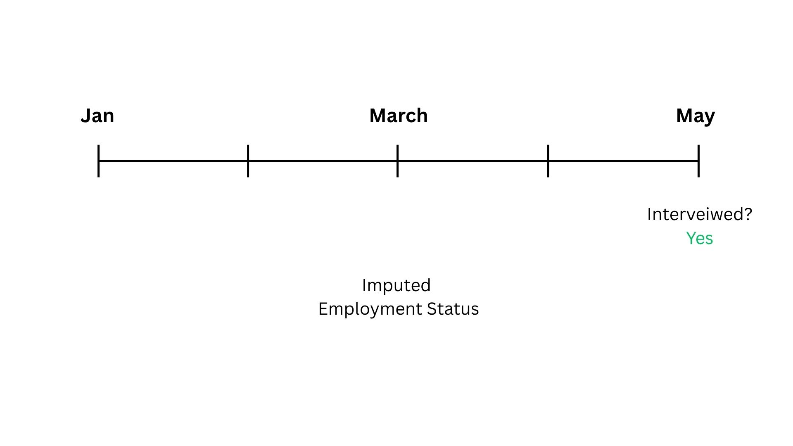

## 4.4.2. Imputation Illustration (2)

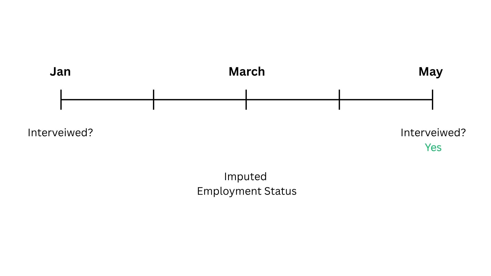

## 4.4.2. Imputation Illustration (3)

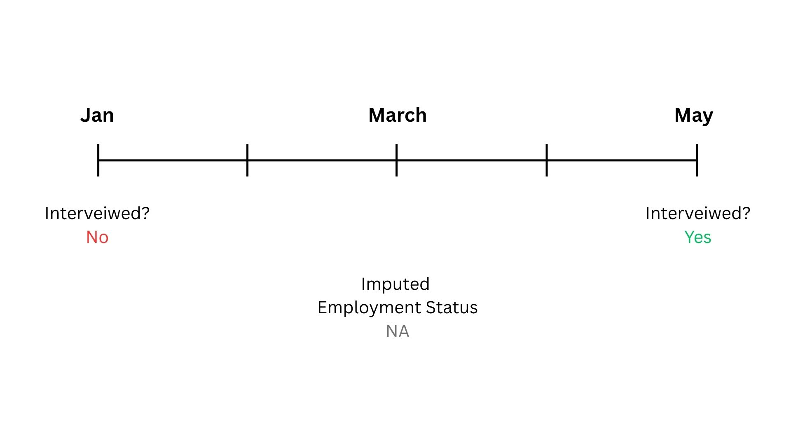

## 4.4.2. Imputation Illustration (4)

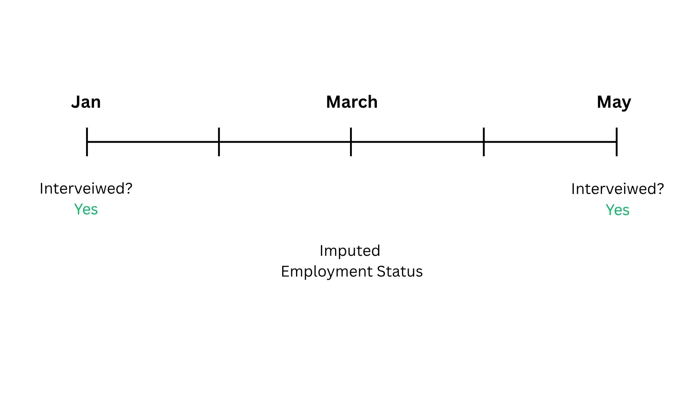

## 4.4.2. Imputation Illustration (5)

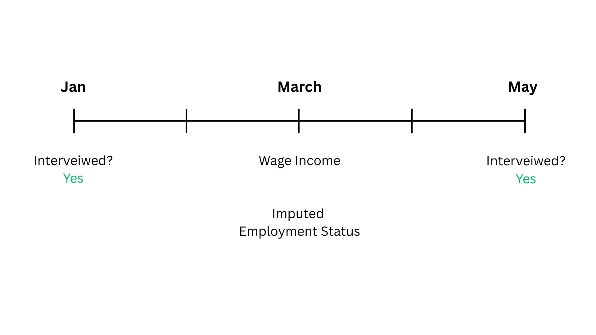

## 4.4.2. Imputation Illustration (6)

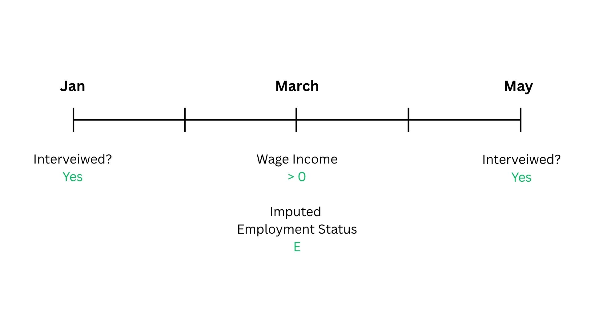

## 4.4.2. Imputation Illustration (7)

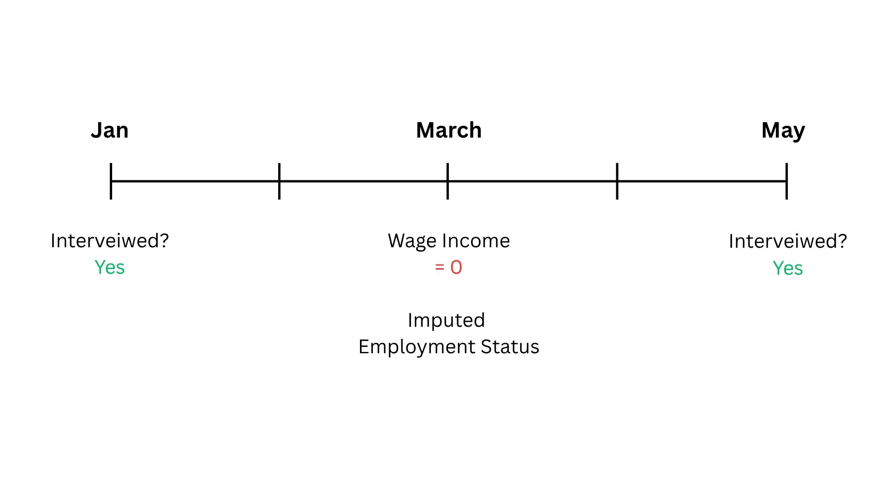

## 4.4.2. Imputation Illustration (8)

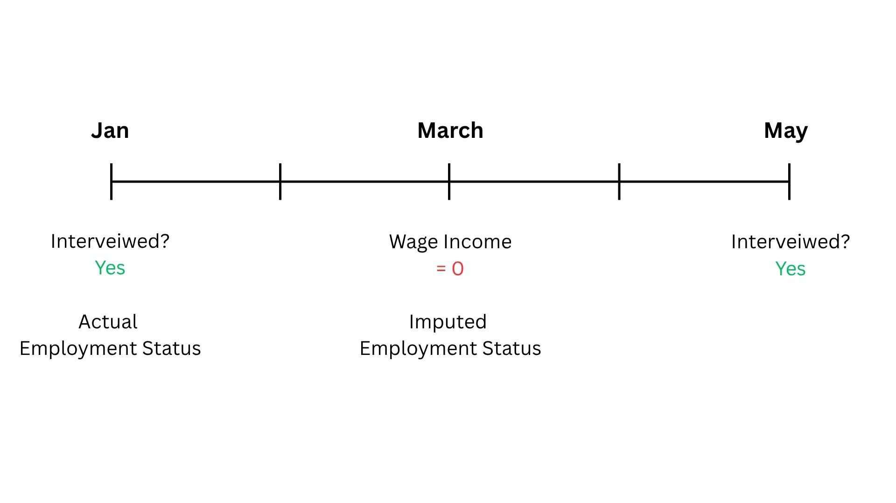

## 4.4.2. Imputation Illustration (9)

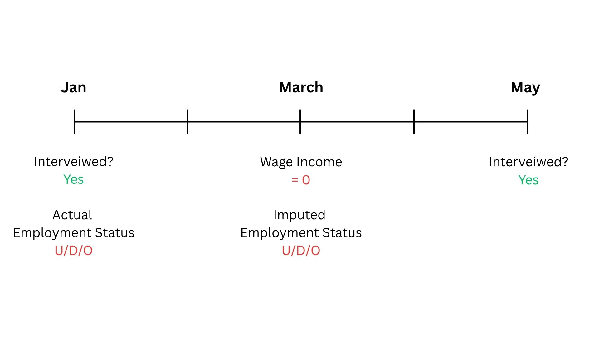

## 4.4.2. Imputation Illustration (10)

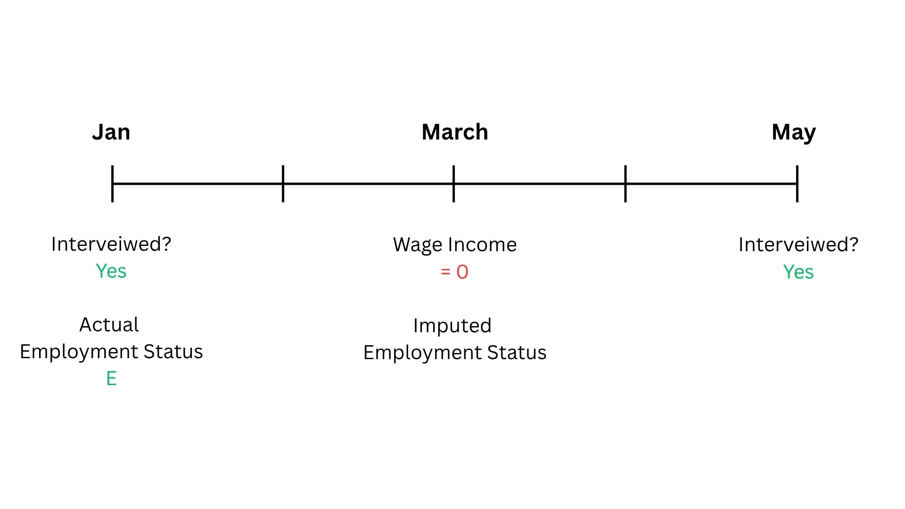

## 4.4.2. Imputation Illustration (11)

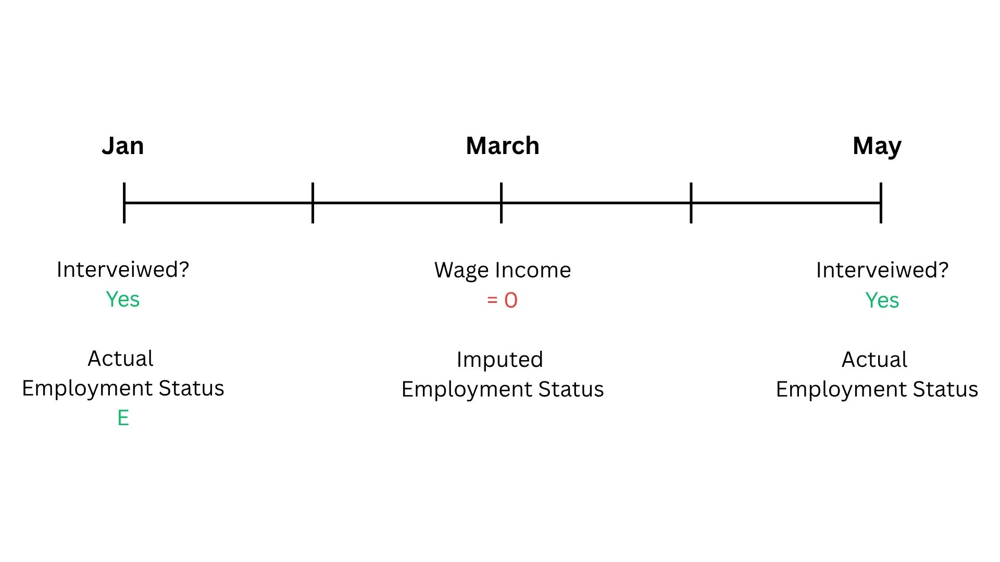

## 4.4.2. Imputation Illustration (12)

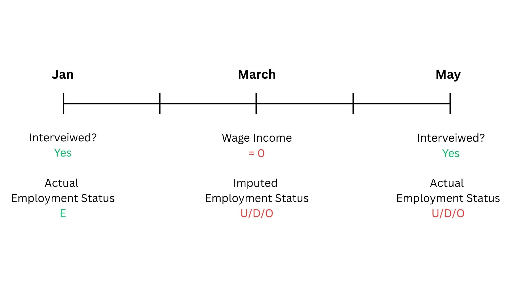

## 4.4.2. Imputation Illustration (13)

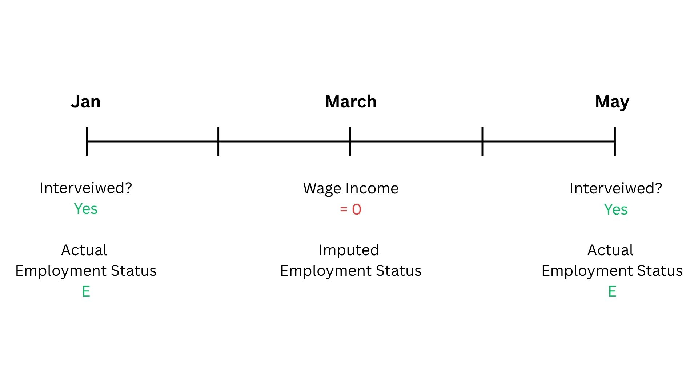

## 4.4.2. Imputation Illustration (14)


# 5. Methodology & Findings

## 5.1. Wave to Wave Transition{.scrollable}

```{r plot}
transition_matrix <- read_rds(here(read_location, "eudo_transitions.Rda"))

transition_matrix |>
  filter(!wave %in% 19:24) |>
  mutate(transition = paste0(state_t0, state_t1)) |>
  mutate(
    transition = factor(
      transition,
      levels = c(
        "EE",
        "EU",
        "ED",
        "EO",
        "UE",
        "UU",
        "UD",
        "UO",
        "DE",
        "DU",
        "DD",
        "DO",
        "OE",
        "OU",
        "OD",
        "OO"
      )
    )
  ) |>
  mutate(p = round(p, 4)) |>
  rowwise() |>
  mutate(wave_date = cmie_wave_duration(wave)) |>
  mutate(wave_date_start = cmie_wave_duration(wave, start_date = T)) |>
  ungroup() |>
  plotly::plot_ly(
    x = ~wave_date_start,
    y = ~p,
    text = ~ paste0(
      "<b>Wave:</b>",
      wave,
      "<br>",
      wave_date
    ),
    color = ~transition,
    type = "scatter",
    mode = "lines+markers",
    visible = "legendonly",

    hovertemplate = paste('<b>p</b>: %{y}', '<br>%{text}')
  ) |>
  plotly::layout(
    margin = list(
      l = 60,
      r = 20,
      t = 20,
      b = 120
    ),
    xaxis = list(
      title = "Wave (Start Date)",
      type = 'date',
      tickformat = "%b %Y"
    ),
    yaxis = list(title = "Transition Probability", rangemode = "tozero"),
    legend = list(title = list(text = "Transition Type"))
  ) |>
  config(displayModeBar = FALSE)
```

## 5.2.1 Current Methodology

- Employment status is either "Employed" or "Non-employed".

- Non-employed individuals are of interest. Failure is defined as transitioning from non-employed to employed.

- Estimate the KM Estimator and Cox PH model.

## 5.2.2. Some Caveats

- Data is non-weighted.

- About 10-15% of the sample has changing religion/caste for the same individual. In this case, only data from the period with initial religion/caste is retained.

- Left-censored data has been excluded. Thus, we only consider individuals who lose employment within the period of observation. 

## 5.3 KM Curves

::: {.panel-tabset}

## Overall
```{r km_overall}
draw_km("km_overall")
```

## COVID

```{r km_covid}
draw_km("km_covid")
```

## Religion

```{r km_religion}
draw_km("km_religion")
```

##  Caste
```{r km_caste}
draw_km("km_caste")
```
:::

## 5.4. Cox PH Model


$$
\begin{align}
h_i(t) &= h_0(t) + \exp(\beta_1\text{Age}_i(t) + \beta_2\text{FamilyIncome}_i(t) +\\ 
& \qquad \beta_3 \textbf{Religion}_i + \beta_4 \textbf{Caste}_i  + \\
& \qquad \beta_5 \textbf{EducationLevel}_i(t)  + \\
& \qquad \beta_6 \textbf{RelationshipWithHOH}_i(t) +\beta_7 \text{Post-COVID}_i)
\end{align}
$$

## Cox PH Model: Results {.scrollable}

<table style="text-align:center; border-collapse:collapse; margin:auto; font-size:75%; line-height:1.05;">
  <tr style="border-top:2px solid black; border-bottom:1px solid black;">
    <th style="text-align:left; padding:3px 10px;">Covariate</th>
    <th style="padding:3px 10px;">Hazard Ratio</th>
  </tr>

  <tr><td style="text-align:left;">Age</td><td>0.975<sup>***</sup></td></tr>
  <tr><td></td><td>(0.0004)</td></tr>

  <tr><td style="text-align:left;">Family Income (₹1000s)</td><td>1.004<sup>***</sup></td></tr>
  <tr><td></td><td>(0.00003)</td></tr>

  <tr><td style="text-align:left; padding-top:4px;">Post-COVID</td><td>0.787<sup>***</sup></td></tr>
  <tr><td></td><td>(0.007)</td></tr>


  <tr><td colspan="2" style="text-align:left; padding-top:4px;"><strong>Religion (ref: Hindu)</strong></td></tr>
  <tr><td style="text-align:left; padding-left:12px;">Muslim</td><td>1.088<sup>***</sup></td></tr>
  <tr><td></td><td>(0.014)</td></tr>
  <tr><td style="text-align:left; padding-left:12px;">Other</td><td>0.662<sup>***</sup></td></tr>
  <tr><td></td><td>(0.015)</td></tr>

  <tr><td colspan="2" style="text-align:left; padding-top:4px;"><strong>Caste (ref: General Caste)</strong></td></tr>
  <tr><td style="text-align:left; padding-left:12px;">Not Stated</td><td>0.982</td></tr>
  <tr><td></td><td>(0.037)</td></tr>
  <tr><td style="text-align:left; padding-left:12px;">OBC/Intermediate Caste</td><td>1.231<sup>***</sup></td></tr>
  <tr><td></td><td>(0.012)</td></tr>
  <tr><td style="text-align:left; padding-left:12px;">SC/ST</td><td>1.164<sup>***</sup></td></tr>
  <tr><td></td><td>(0.015)</td></tr>

  <tr><td colspan="2" style="text-align:left; padding-top:4px;"><strong>Education (ref: No Education)</strong></td></tr>
  <tr><td style="text-align:left; padding-left:12px;">Primary School</td><td>1.119<sup>***</sup></td></tr>
  <tr><td></td><td>(0.040)</td></tr>
  <tr><td style="text-align:left; padding-left:12px;">Middle School</td><td>1.139<sup>***</sup></td></tr>
  <tr><td></td><td>(0.041)</td></tr>
  <tr><td style="text-align:left; padding-left:12px;">High School</td><td>0.941<sup>*</sup></td></tr>
  <tr><td></td><td>(0.033)</td></tr>
  <tr><td style="text-align:left; padding-left:12px;">Vocational</td><td>0.502<sup>***</sup></td></tr>
  <tr><td></td><td>(0.031)</td></tr>
  <tr><td style="text-align:left; padding-left:12px;">Undergraduate and Higher</td><td>0.940<sup>*</sup></td></tr>
  <tr><td></td><td>(0.033)</td></tr>

  <tr><td colspan="2" style="text-align:left; padding-top:4px;"><strong>Relationship with Household Head (ref: Household Head)</strong></td></tr>
  <tr><td style="text-align:left; padding-left:12px;">Other</td><td>0.495<sup>***</sup></td></tr>
  <tr><td></td><td>(0.013)</td></tr>
  <tr><td style="text-align:left; padding-left:12px;">Son</td><td>0.498<sup>***</sup></td></tr>
  <tr><td></td><td>(0.007)</td></tr>

  <tr style="border-top:1px solid black;">
    <td style="text-align:left; padding-top:3px;">Observations</td><td>1,363,213</td>
  </tr>
  <tr><td style="text-align:left;">R<sup>2</sup></td><td>0.009</td></tr>
  <tr><td style="text-align:left;">Max. Possible R<sup>2</sup></td><td>0.614</td></tr>
  <tr><td style="text-align:left;">Log Likelihood</td><td>−642,159.900</td></tr>
  <tr><td style="text-align:left;">Wald Test</td><td>31,627.100<sup>***</sup> (df = 15)</td></tr>
  <tr><td style="text-align:left;">LR Test</td><td>12,242.400<sup>***</sup> (df = 15)</td></tr>
  <tr><td style="text-align:left;">Score (Logrank) Test</td><td>51,664.080<sup>***</sup> (df = 15)</td></tr>

  <tr style="border-top:2px solid black;">
    <td colspan="2" style="text-align:right; padding-top:3px;">
      <small>
        <em>Note:</em> Standard errors in parentheses.
        <sup>*</sup>p&lt;0.1;
        <sup>**</sup>p&lt;0.05;
        <sup>***</sup>p&lt;0.01.
      </small>
    </td>
  </tr>
</table>

## Cox PH Model: Diagnostics {.smaller .scrollable}

```{r zph}
cox_model_zph <- read_rds(here(read_location, "cox_main_zph.rds"))
zph_table <- as.data.frame(cox_model_zph$table) |>
  rownames_to_column("Covariate") |>
  mutate(
    Covariate = recode(
      Covariate,
      "age_yrs" = "Age",
      "family_income_thousands" = "Family Income (₹1000s)",
      "religion" = "Religion",
      "caste_category" = "Caste",
      "edu" = "Education",
      "relation_with_hoh" = "Relationship with Household Head",
      "post_covid" = "Post-COVID",
      "GLOBAL" = "Global Test"
    ),
    p = ifelse(p < 0.001, "<0.001", sprintf("%.3f", p))
  )

knitr::kable(
  zph_table,
  digits = 3,
  col.names = c("Covariate", "Chi-square", "df", "p-value")
)
```

# 6. Way Forward

## 6.1. Possible Strategies for PH Violation

- Stratification: 
$$
h_s(t|\mathbf{X}(t)) = h_{s0}(t) \exp (\boldsymbol{\beta}\trans \mathbf{X}(t))
$$

- Time-varying Covariates: 
$$
h(t|\mathbf{X}(t)) = h_0(t) \exp (\boldsymbol{\beta}(t)\trans \mathbf{X}(t))
$$

- Accelerated Failure Time (AFT) Models (Eg: Weibull)

## 6.2. Immediate Tasks 

- Modify/replace Cox PH Model.

- Weight the data.

- Account for left censoring (Turnbull, Interval Censored Cox).

- Investigate changing caste/religion.

## 6.3 (Not So) Long-Run Tasks 

- Incorporate competing risks and recurrent events.

- Address some economic theory.

## References

::: {#refs}
:::
