## Research Question

::: hidden
\newcommand{\trans}[0]{^\mathsf{T}}
:::

```{=html}
<style>
/* Strike through the original word */
.reveal .fragment.strike.visible {
  text-decoration: line-through;
  text-decoration-color: red;
  opacity: 1;
}

/* Keep replacement hidden until its turn */
.reveal .fragment.replacement {
  opacity: 0;
}

/* Show replacement on the next click */
.reveal .fragment.replacement.visible {
  opacity: 1;
}

/* Shrink the tab header text and decrease padding */
.panel-tabset .nav-tabs .nav-link {
  font-size: 0.85rem;      /* Adjust font size as needed */
  padding: 0.25rem 0.5rem; /* Reduces top/bottom and left/right spacing */
}
</style>
```


```{r setup}
#| include: false
rm(list = ls())

if (!require("pacman")) {
  install.packages("pacman")
}
pacman::p_load(
  here,
  tidyverse,
  qs2,
  plotly,
  ggsurvfit,
  tidycmprsk,
  gt,
  shinylive
)

read_location <- here("data", "eda", "2026-11-05_presentation_assessment")

cmie_wave_duration <- function(wave_num, start_date = F) {
  label_vec <- c(
    "Jan-Apr (2014)",
    "May-Aug (2014)",
    "Sep-Dec (2014)",
    "Jan-Apr (2015)",
    "May-Aug (2015)",
    "Sep-Dec (2015)",
    "Jan-Apr (2016)",
    "May-Aug (2016)",
    "Sep-Dec (2016)",
    "Jan-Apr (2017)",
    "May-Aug (2017)",
    "Sep-Dec (2017)",
    "Jan-Apr (2018)",
    "May-Aug (2018)",
    "Sep-Dec (2018)",
    "Jan-Apr (2019)",
    "May-Aug (2019)",
    "Sep-Dec (2019)",
    "Jan-Apr (2020)",
    "May-Aug (2020)",
    "Sep-Dec (2020)",
    "Jan-Apr (2021)",
    "May-Aug (2021)",
    "Sep-Dec (2021)",
    "Jan-Apr (2022)",
    "May-Aug (2022)",
    "Sep-Dec (2022)",
    "Jan-Apr (2023)",
    "May-Aug (2023)",
    "Sep-Dec (2023)",
    "Jan-Apr (2024)",
    "May-Aug (2024)",
    "Sep-Dec (2024)",
    "Jan-Apr (2025)",
    "May-Aug (2025)",
    "Sep-Dec (2025)",
    "Jan-Apr (2026)"
  )

  if (wave_num < 1 | wave_num > length(label_vec)) {
    warning(paste0("Enter integer between 1 and ", length(label_vec)))
    return(NULL)
  }

  duration_label <- label_vec[[wave_num]]

  if (start_date == T) {
    start_month <- sub("-.*", "", sub(" .*", "", duration_label))
    year <- sub(".*\\(([0-9]{4})\\)", "\\1", duration_label)

    as.Date(
      paste(start_month, "1", year),
      format = "%b %d %Y"
    )
  } else {
    return(duration_label)
  }
}
```

::: nonincremental
Among unemployed males in urban India, what is the relationship of their socio-economic characteristics with:

i)  The duration of their unemployment?

ii) The kind of exit they make from unemployment — a) re-employment OR b) quitting the labour force?
:::

## Why Study Unemployment Duration?

. . . 

Longer unemployment duration is associated with:

- Prolonged loss of income.

-  Lower re-employment probability and earnings [@berg_ours; @cohen_et_al].
  
- *Causes* statistical discrimination from employers[@eriksson_rooth; @kroft_et_al; @belle_et_al].

- Increased psychological distress [@paul_moser; @ryan_et_al] 
  
- Unhappier family relationships [@blom_harris].

## Data

- Centre for Monitoring Indian Economy (CMIE) - Consumer Pyramid Household Survey (CPHS).

- National-level panel dataset that interviews individuals 3 times a year, each cycle called a *wave*.

- Data from two periods: 2016-2019 and 2022-2025. <br> (8 years, 24 waves)

- Relevant employment indicators introduced in 2016. <br> Data from 2020 & 2021 excluded due to COVID-induced disruptions.

## Exclusions from Sample

- **Females:** Aggregate employment statistics on females estimated from the CPHS diverge significantly from the official PLFS estimates [@abraham_shrivastava].

- **Rural Areas:** To improve reliability of an imputation exercise undertaken in this study.

## Unemployed $\rightarrow$ Unemployed <br> (Wave Level)

```{r read_matrix}
#| include: false
transition_matrix <- read_rds(here(read_location, "euo_transitions.rds")) |>
  #filter(!wave %in% 19:24) |>
  mutate(p = ifelse(wave %in% 19:24, NA, p)) |>
  mutate(transition = paste0(state_t0, state_t1)) |>
  mutate(p = round(p, 4)) |>
  rowwise() |>
  mutate(wave_date = cmie_wave_duration(wave)) |>
  mutate(wave_date_start = cmie_wave_duration(wave, start_date = T)) |>
  ungroup()
```

```{r plot_func}
plot_transition <- function(transition_matrix, line_color = "blue") {
  transition_matrix |>
    plot_ly(
      x = ~wave_date_start,
      y = ~p,
      line = list(color = line_color),
      marker = list(color = line_color),
      text = ~ paste0(
        "<b>Wave:</b>",
        wave,
        "<br>",
        wave_date
      ),
      type = "scatter",
      mode = "lines+markers",

      hovertemplate = paste('<b>p</b>: %{y}', '<br>%{text}<extra></extra>')
    ) |>
    layout(
      margin = list(
        #l = 60,
        r = 20,
        #t = 20,
        b = 120
      ),
      xaxis = list(
        title = "Wave (Start Date)",
        type = 'date',
        tickformat = "%b %Y"
      ),
      yaxis = list(title = "Transition Probability", rangemode = "tozero"),
      legend = list(title = list(text = "Transition Type"))
    ) |>
    config(displayModeBar = FALSE)
}
```

```{r plot_uu}
transition_matrix |>
  filter(transition == "UU") |>
  plot_transition(line_color = "red")
```

## Unemployed $\rightarrow$ Employed <br> (Wave Level)

```{r plot_ue}
transition_matrix |>
  filter(transition == "UE") |>
  plot_transition(line_color = "blue")
```


## Imputation of Employment Status

- In CPHS, ***employment indicators*** of an individual are available at a *wave-level frequency* (4 months).

- However, ***income from wages*** are available at a *monthly frequency*.

- @kannan uses this impute monthly employment status: <br> Income from wages $= 0 \implies$ *Non-Employed* <br> Income from wages $> 0 \implies$ *Employed*

- This study extends this method to differentiate between *unemployed* and *out-of-labour-force* individuals among the *non-employed*.

## Imputation Illustration (1)

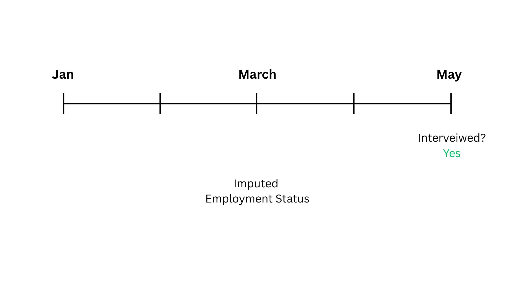

## Imputation Illustration (2)

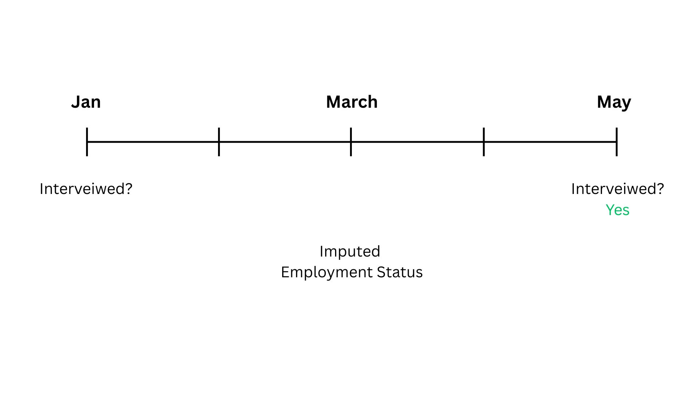

## Imputation Illustration (3)

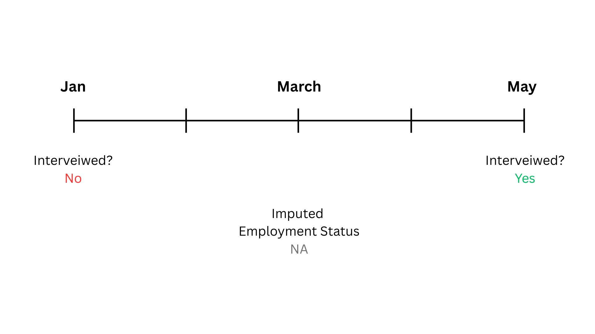

## Imputation Illustration (4)

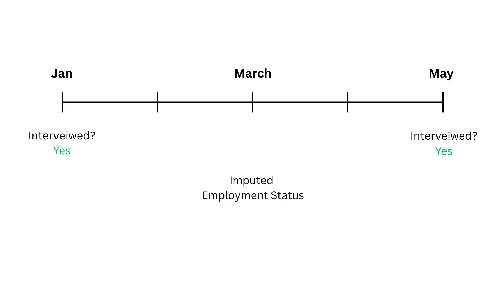

## Imputation Illustration (5)

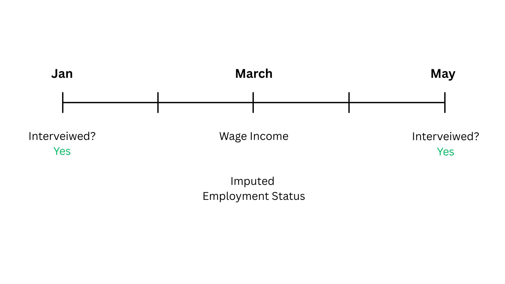

## Imputation Illustration (6)

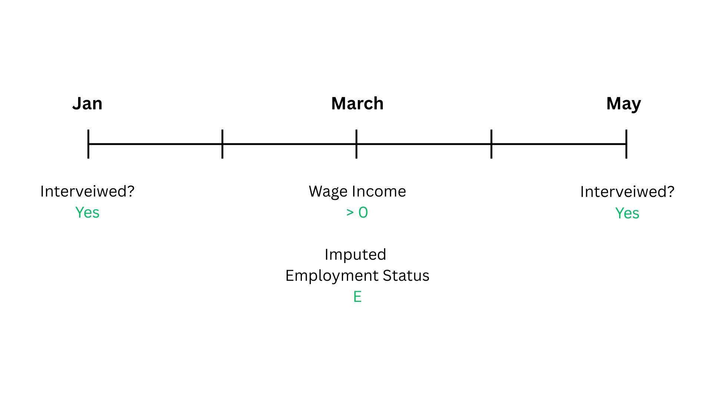

## Imputation Illustration (7)

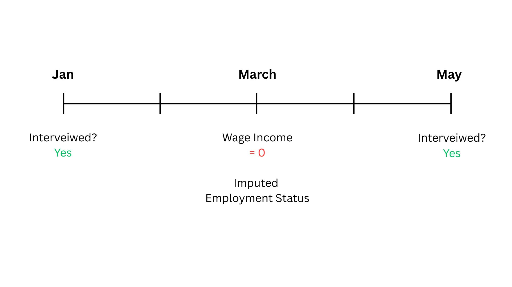

## Imputation Illustration (8)

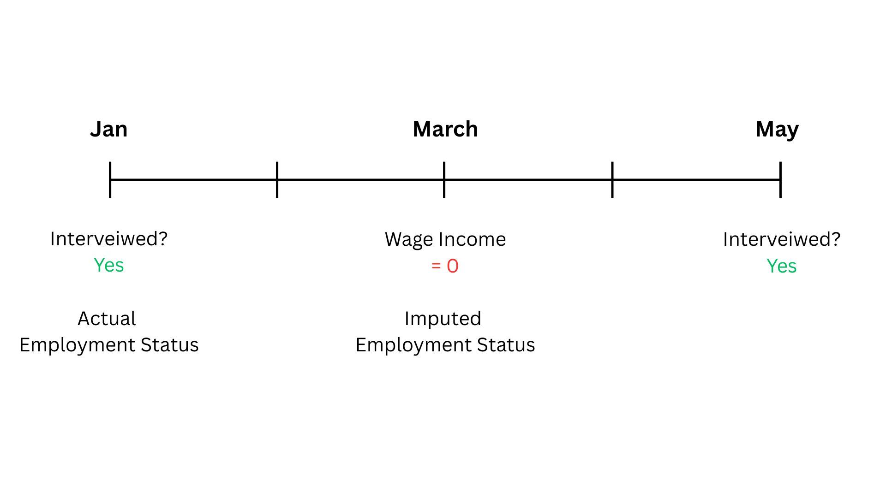

## Imputation Illustration (9)

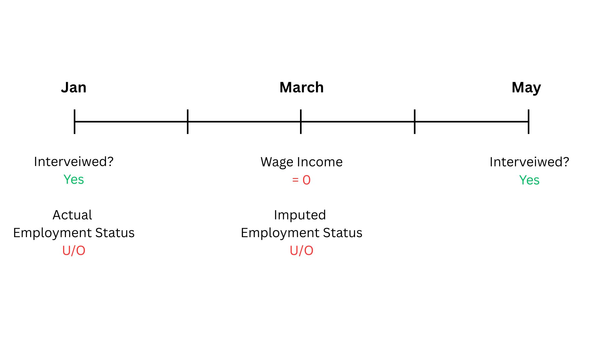

## Imputation Illustration (10)

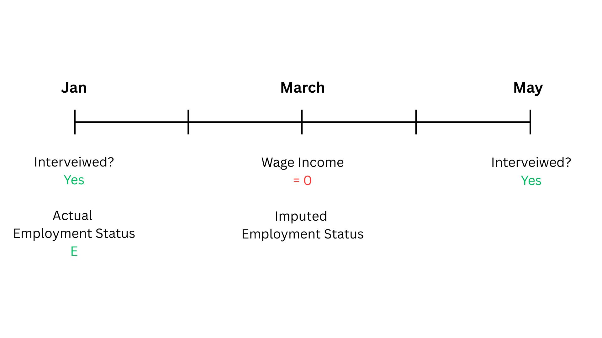

## Imputation Illustration (11)

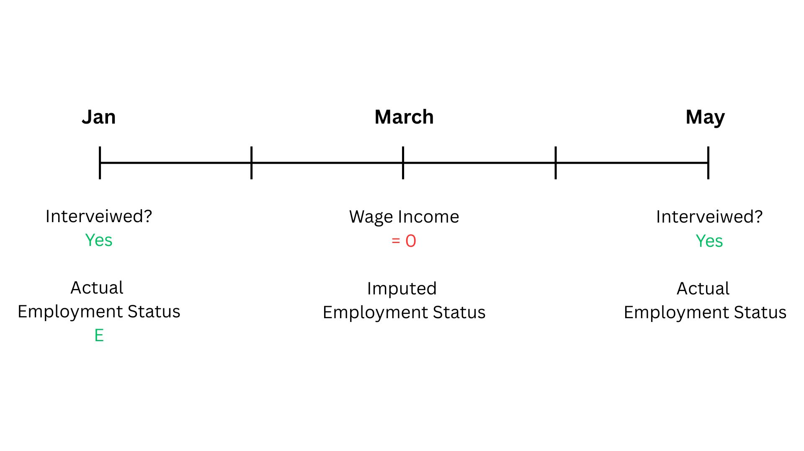

## Imputation Illustration (12)

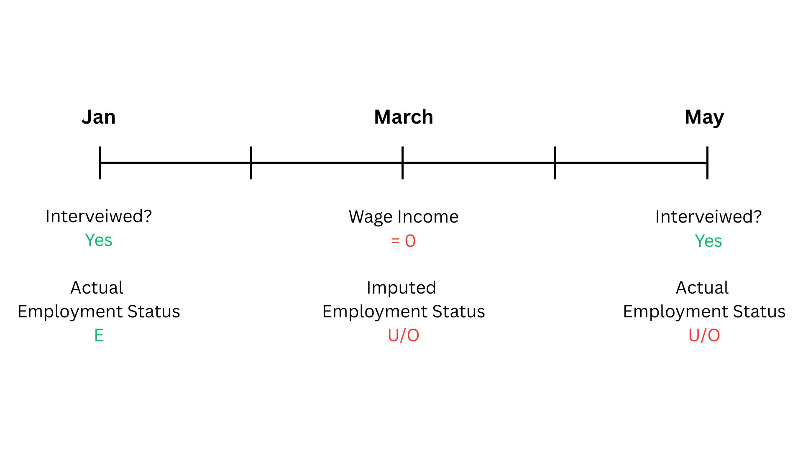

## Imputation Illustration (13)

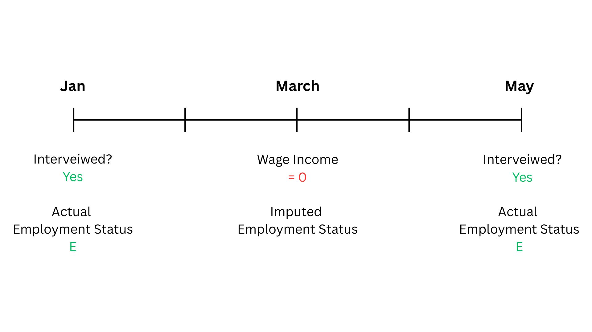

## Imputation Illustration (14)


## Survival Analysis

- Analysing time-to-event.

- **Biostatistics:** How long does a patient survive after they get a disease? <br> **Reliability Engineering:** How long will a machine be serviceable?

- *Survival Time* $\rightarrow$ Unemployment Duration

- *Failure/Death* $\rightarrow$ i) Re-employment ii) Quitting the Labour Force <br> ***\[Competing-risks framework\]***

## Censoring

- The key strength of survival analysis is to account for *censoring*.

- **Censoring:** Incomplete observation of time-to-event for some individuals due to random factors.

- Could occur due to i) attrition, and ii) the study period ending.

- Not accounting for censoring could lead to bias.

## Research Gap 

- @kannan uses OLS regression and survival analysis (Nelson Aalen Estimator) on CMIE-CPHS data. Does not control for covariates when using survival analysis.
  
- @menon_nath_job_search use the Cox PH model on PLFS Urban data. However, panel length is limited to 4 visits in one year, after which households are dropped.
  
- Using a competing-risks framework.
  
- Using post-COVID data.

## Overview of Methodology

::: nonincremental
i)  **Aalen-Johansen Estimator:** Exploratory Analysis

ii) **Log Logistic Model:** Regression

iii) **Random Survival Forest:** Prediction + Robustness
:::

## Aalen-Johansen Estimator

- Let $T$ be a random variable denoting unemployment duration.

- Cumulative Incidence Function
  $$
  \text{CIF}_k(t) = \mathbb{P}(T \leq t, \text{Failure} = k)
  $$
  $k \in \{\text{Re-Employment}, \text{Quitting}\}$

- The Aalen-Johansen Estimator is a non-parametric estimator of the CIF.

## Aalen-Johansen Estimator: Results {.smaller}

```{r aj}
aj_overall <- qs_read(here(read_location, "aj_overall.qs2"))
aj_religion <- qs_read(here(read_location, "aj_religion.qs2"))
aj_caste <- qs_read(here(read_location, "aj_caste.qs2"))
aj_edu <- qs_read(here(read_location, "aj_edu.qs2"))
aj_relation <- qs_read(here(read_location, "aj_relation.qs2"))

plot_re_employment <- function(model) {
  model |>
    ggcuminc("Re-Employment") +
    add_confidence_interval() +
    xlab("Time (in Months)") +
    ylab("P(Re-Employment)") +
    theme(legend.position = "right")
}

plot_quitting <- function(model) {
  model |>
    ggcuminc("Quitting") +
    add_confidence_interval() +
    xlab("Time (in Months)") +
    ylab("P(Quitting)") +
    theme(legend.position = "right")
}
```

::: {.panel-tabset}

## Overall

```{r aj_overall}
aj_overall |>
  ggcuminc(c("Re-Employment", "Quitting")) +
  add_confidence_interval() +
  xlab("Time (in Months)") +
  ylab("P(Outcome)") +
  theme(legend.position = "right")
```

## Religion

::: {.panel-tabset}

## Re-Employment
```{r aj_religion_re_emp}
aj_religion |>
  plot_re_employment()
```

## Quitting
```{r aj_religion_quitting}
aj_religion |>
  plot_quitting()
```
:::

## Caste

::: {.panel-tabset}

## Re-Employment
```{r aj_caste_re_emp}
{
  aj_caste |>
    plot_re_employment() -> p

  p$data <- p$data |>
    filter(strata != "Not Stated")

  p
}
```

## Quitting
```{r aj_caste_quitting}
{
  aj_caste |>
    plot_quitting() -> p

  p$data <- p$data |>
    filter(strata != "Not Stated")

  p
}
```
:::

## Education Level

::: {.panel-tabset}

## Re-Employment
```{r aj_edu_re_emp}
aj_edu |>
  plot_re_employment()
```

## Quitting
```{r aj_edu_quitting}
aj_edu |>
  plot_quitting()
```
:::

## Relation to Head of Household

::: {.panel-tabset}

## Re-Employment
```{r aj_relation_re_emp}
aj_relation |>
  plot_re_employment()
```

## Quitting
```{r aj_relation_quitting}
aj_relation |>
  plot_quitting()
```
:::
:::


## Log-Logistic Model

. . .

$$
\ln(T) = \beta_0 + \boldsymbol{\beta}^\mathsf{T}\mathbf{X} + \sigma \epsilon
$$

. . .

::: nonincremental
where,

- $\mathbf{X}$ is a vector of covariates.

- $\sigma \in (0, \infty)$ is the *shape* parameter.

- $\epsilon$ is the error term following the standard logistic distribution.
:::

## Log-Logistic Model: Interpretation

- Take two groups, denoted by $x_j \in \{0, 1\}$, with corresponsing coefficient $\beta_j$.

- Take any quantile $q$.
  $$\frac{\text{Unemployment Duration}_q(x_j=1)}{\text{Unemployment Duration}_q(x_j=0)} = e^{\beta_j}$$

- Eg: Say $e^{\beta_j} = 2$. [The *median*]{.fragment .strike}[ &nbsp; At *any quantile*, ]{.fragment .replacement} <br> unemployment duration for individuals in group $1$ is <br> ***twice*** the unemployment duration of those in group $0$.

## Log-Logistic Model: Results{.smaller .scrollable}
:::{.nonincremental}
:::{.panel-tabset}

## Re-Employment

```{r ll_re_employment}

ll_re_employment <- qs_read(here(read_location, "ll_re_employment.qs2"))

ll_re_employment |>
  tidy() |>
  select(term, estimate, p.value) |>
  filter(term != "(Intercept)") |>
  mutate(
    estimate_num = exp(estimate),
    estimate = paste0(
      sprintf("%.3f", estimate_num),
      case_when(
        p.value < 0.01 ~ "***",
        p.value < 0.05 ~ "**",
        p.value < 0.1 ~ "*",
        TRUE ~ ""
      )
    ),
    category = case_when(
      term %in%
        c(
          "age",
          "family_income_thousands"
        ) ~ "",
      grepl("^religion", term) ~ "Religion (Baseline: Hindu)",
      grepl("^caste", term) ~ "Caste (Baseline: Upper Caste)",
      grepl("^edu", term) ~ "Education Level (Baseline: No Schooling)",
      grepl(
        "^relation",
        term
      ) ~ "Relation to Head of Household (Baseline: Self)",
      term == "Log(scale)" ~ " "
    ),
    term = case_when(
      term == "age" ~ "Age",
      term == "family_income_thousands" ~ "Family Income (INR 1000)",
      term == "religionMuslim" ~ "Muslim",
      term == "religionOther" ~ "Other",
      term == "casteOBC/Intermediate Caste" ~ "OBC / Intermediate Caste",
      term == "casteSC" ~ "SC",
      term == "casteST" ~ "ST",
      term == "casteNot Stated" ~ "Not Stated",
      term == "eduPrimary School" ~ "Primary School",
      term == "eduMiddle School" ~ "Middle School",
      term == "eduHigh School" ~ "High School",
      term == "eduVocational Education" ~ "Vocational Education",
      term == "eduHigher Education" ~ "Higher Education",
      term == "relationSon" ~ "Son",
      term == "relationOther" ~ "Other",
      term == "Log(scale)" ~ "Scale",
      TRUE ~ term
    ),
    order = case_when(
      term == "Log(scale)" ~ 2L,
      TRUE ~ 1L
    )
  ) |>
  arrange(order) |>
  select(category, term, estimate, estimate_num) |>
  gt(groupname_col = "category") |>
  cols_label(
    term = "Variable",
    estimate = "Time Ratio"
  ) |>
  cols_hide(columns = estimate_num) |>
  tab_style(
    style = cell_text(weight = "bold"),
    locations = cells_row_groups()
  ) |>
  tab_style(
    style = cell_text(
      weight = "bold",
      size = px(22)
    ),
    locations = cells_column_labels()
  ) |>
  tab_style(
    style = cell_text(color = "#1E8449"),
    locations = cells_body(
      columns = estimate,
      rows = estimate_num < 1 & term != "Scale"
    )
  ) |>
  tab_style(
    style = cell_text(color = "red"),
    locations = cells_body(
      columns = estimate,
      rows = estimate_num > 1 & term != "Scale"
    )
  ) |>
  tab_source_note(
    source_note = md(
      paste0(
        "n = ",
        format(nobs(ll_re_employment), big.mark = ",")
      )
    )
  ) |>
  tab_source_note(
    source_note = html(
      "<em>Note:</em>
        <ol>
      <li>*** p < 0.01, ** p < 0.05, * p < 0.10. </li>
      <li> Estimates are exponentiated coefficients (time ratios), except the scale parameter.</li>
      <li> Observations that quit the labour force are taken to be censored. Given the assumption of non-informative censoring, this means that these observations would have had similar probabilities for re-employment had they not quit the labour force.</li>"
    )
  ) |>
  opt_table_font(
    size = px(21)
  ) |>
  tab_options(table.width = pct(60))
```

## Quitting

```{r ll_quitting}

ll_quitting <- qs_read(here(read_location, "ll_quitting.qs2"))

ll_quitting |>
  tidy() |>
  select(term, estimate, p.value) |>
  filter(term != "(Intercept)") |>
  mutate(
    estimate_num = exp(estimate),
    estimate = paste0(
      sprintf("%.3f", estimate_num),
      case_when(
        p.value < 0.01 ~ "***",
        p.value < 0.05 ~ "**",
        p.value < 0.1 ~ "*",
        TRUE ~ ""
      )
    ),
    category = case_when(
      term %in%
        c(
          "age",
          "family_income_thousands"
        ) ~ "",
      grepl("^religion", term) ~ "Religion (Baseline: Hindu)",
      grepl("^caste", term) ~ "Caste (Baseline: Upper Caste)",
      grepl("^edu", term) ~ "Education (Baseline: No Schooling)",
      grepl(
        "^relation",
        term
      ) ~ "Relation to Head of Household (Baseline: Self)",
      term == "Log(scale)" ~ " "
    ),
    term = case_when(
      term == "age" ~ "Age",
      term == "family_income_thousands" ~ "Family Income (INR 1000)",
      term == "religionMuslim" ~ "Muslim",
      term == "religionOther" ~ "Other",
      term == "casteOBC/Intermediate Caste" ~ "OBC / Intermediate Caste",
      term == "casteSC" ~ "SC",
      term == "casteST" ~ "ST",
      term == "casteNot Stated" ~ "Not Stated",
      term == "eduPrimary School" ~ "Primary School",
      term == "eduMiddle School" ~ "Middle School",
      term == "eduHigh School" ~ "High School",
      term == "eduVocational Education" ~ "Vocational Education",
      term == "eduHigher Education" ~ "Higher Education",
      term == "relationSon" ~ "Son",
      term == "relationOther" ~ "Other",
      term == "Log(scale)" ~ "Scale",
      TRUE ~ term
    ),
    order = case_when(
      term == "Log(scale)" ~ 2L,
      TRUE ~ 1L
    )
  ) |>
  arrange(order) |>
  select(category, term, estimate, estimate_num) |>
  gt(groupname_col = "category") |>
  cols_label(
    term = "Variable",
    estimate = "Time Ratio"
  ) |>
  cols_hide(columns = estimate_num) |>
  tab_style(
    style = cell_text(weight = "bold"),
    locations = cells_row_groups()
  ) |>
  tab_style(
    style = cell_text(
      weight = "bold",
      size = px(22)
    ),
    locations = cells_column_labels()
  ) |>
  tab_style(
    style = cell_text(color = "#1E8449"),
    locations = cells_body(
      columns = estimate,
      rows = estimate_num < 1 & term != "Scale"
    )
  ) |>
  tab_style(
    style = cell_text(color = "red"),
    locations = cells_body(
      columns = estimate,
      rows = estimate_num > 1 & term != "Scale"
    )
  ) |>
  tab_source_note(
    source_note = md(
      paste0(
        "n = ",
        format(nobs(ll_re_employment), big.mark = ",")
      )
    )
  ) |>
  tab_source_note(
    source_note = html(
      "<em>Note:</em>
        <ol>
      <li>*** p < 0.01, ** p < 0.05, * p < 0.10. </li>
      <li> Estimates are exponentiated coefficients (time ratios), except the scale parameter.</li>
      <li> Observations that get re-employed are taken to be censored. Given the assumption of non-informative censoring, this means that these observations would have had similar probabilities for quitting the labour force had they not gotten re-employed.</li>"
    )
  ) |>
  opt_table_font(
    size = px(21)
  ) |>
  tab_options(table.width = pct(60))
```
:::
:::

## Random Survival Forests (RSF)

- Extends the random forests method to work on survival data.

- Non-parametric, highly flexible.

- Provides individualized CIFs.

## Decison Trees

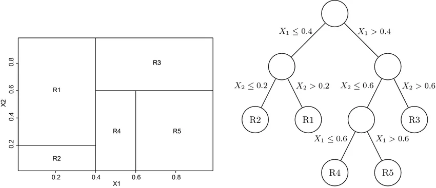{fig-alt="Decision Trees: Partitions" fig-align="center"}

## Survival Trees 

- **Splitting Rule:** Gray's test
  
- **Outcome Variable:** CIF
  
- Highly flexible $\implies$ [Captures non-linearities]{style="color: green;"}, [Tends to overfit]{style="color: red;"}.
  
- Solution: Grow multiple trees (a forest) and average them out.

## Survival Trees $\rightarrow$ RSF
  
- **Bagging** aka Bootstrap Aggregation
  
- **Bootstrapping:** Take $n$ bootstrap samples from the training data and grow a tree from each of them.
  
- **De-correlation:** Train each tree with a random subset of covariates. 
  
- **Aggregation:** Obtain prediction from every tree, and average them out.
  
- This reduces the tendency of the model to overfit, while preserving its flexibility.

## RSF Predictions{.smaller}

::: {.panel-tabset}

## Interactive

```{=html}
<iframe src="https://rfsapp.duckdns.org/" width="1000px" height="500px" style="border:none;"></iframe>
```

## Static 1

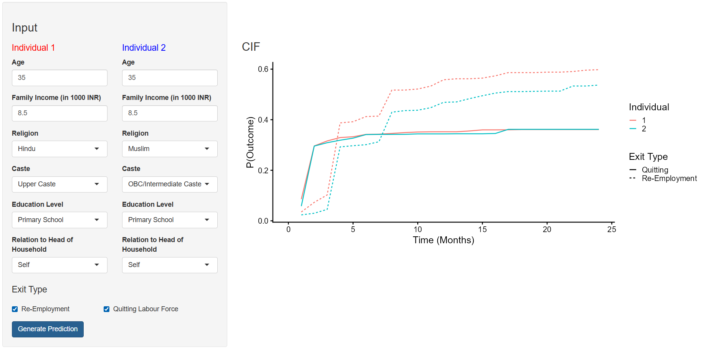

## Static 2

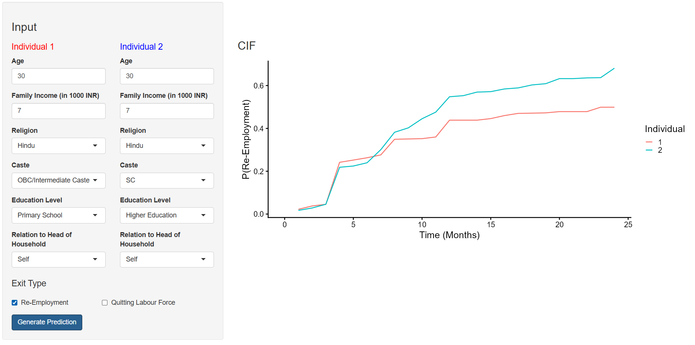

## Static 3

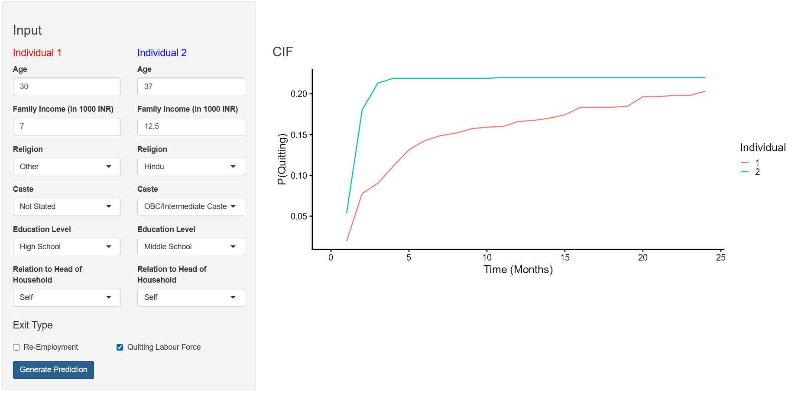

:::

## RSF Prediction Example

```{shinylive-r}
#| standalone: true
#| viewerHeight: 500

library(shiny)
library(ggplot2)
library(dplyr)
library(readr)

cif_data <- read_csv("animation_cif_tibble.csv")

ui <- fluidPage(
  #titlePanel("Family Income Simulation"),

  sidebarLayout(
    sidebarPanel(
      sliderInput(
        inputId = "family_income",
        label = "Family Income",
        min = 0,
        max = 25,
        value = 1,
        step = 1,
        animate = animationOptions(
          interval = 500,
          loop = FALSE
        )
      ),

      textOutput("income_value")
    ),

    mainPanel(
      plotOutput("curve_plot")
    )
  )
)

server <- function(input, output, session) { 
  # Display selected value
  output$income_value <- renderText({
    paste0("INR ", input$family_income, ",000")
  })

  # Plot curve
  output$curve_plot <- renderPlot({
    income <- input$family_income

    cif_data |>
      filter(family_income == income) |> 
      ggplot(aes(
        x = time,
        y = cif,
        colour = Religion
      )) +
      geom_line() +
      ylab("P(Re-Employment)") +
      coord_cartesian(ylim = c(0, 0.8)) +
      theme_linedraw()
  })
}

shinyApp(ui = ui, server = server)

## file: animation_cif_tibble.csv

```


## Work in Progress 

- Accounting for the kinds of jobs individuals hold when losing employment and at re-employment, in terms of formality and earnings.

- RSF can perform better with more intensive training.

## References

::: {#refs}
:::

# Extras

## Unemployed $\rightarrow$ OLF (Wave Level)

```{r plot_uo}
transition_matrix |>
  filter(transition == "UO") |>
  plot_transition(line_color = "magenta")
```

